# Theme blocks

Blocks are the building pieces you add inside sections. The blocks below can be added to any section that accepts theme blocks.

## How to access

1. **Go to** Shopify Admin → Online Store → Themes.
2. **Click** Customize on your active theme.
3. Select a section, then click **Add block** and choose the block.

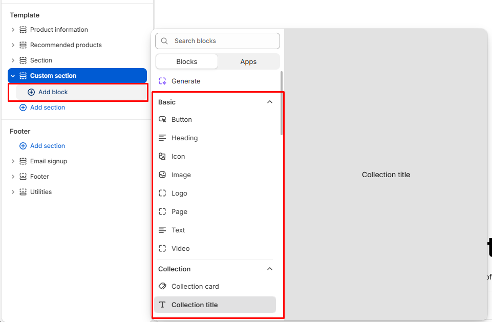

## Accelerated checkout

This block has no settings of its own.

## Accordion

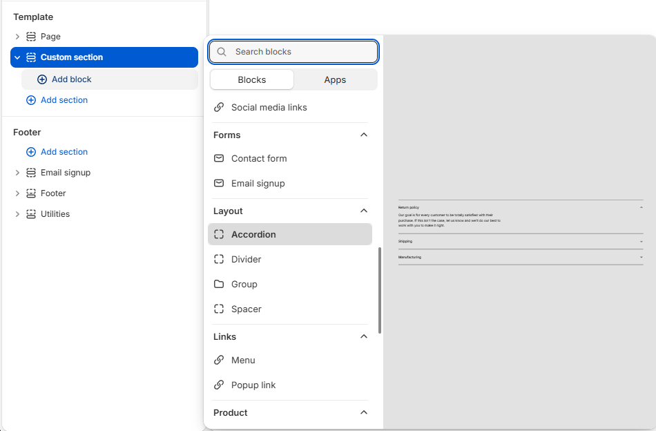

| Setting | Description |
| ------- | ----------- |
| Icon | Sets the icon. Choose from Caret or Plus. |
| Dividers | Enables or disables dividers. |
| Divider color | Sets the divider color. |
| Heading preset | Sets the heading preset. Choose from Default, Paragraph, Heading 1, Heading 2, Heading 3, Heading 4, Heading 5, or Heading 6. Edit presets in theme settings. |
| Appearance |  |
| Background color | Sets the background color. |
| Text color | Sets the text color. |
| Borders |  |
| Style | Sets the style for borders. Choose from None or Solid. |
| Thickness | Sets the thickness for borders. Range: 0–100 px. |
| Opacity | Sets the opacity for borders. Range: 0–100%. |
| Color | Sets the color. |
| Corner radius | Sets the corner radius for borders. Range: 0–100 px. |
| Padding |  |
| Top | Sets the top padding. Range: 0–100 px. |
| Bottom | Sets the bottom padding. Range: 0–100 px. |
| Left | Sets the left padding. Range: 0–100 px. |
| Right | Sets the right padding. Range: 0–100 px. |

## Add to cart

| Setting | Description |
| ------- | ----------- |
| Style | Sets the style. Choose from Primary, Secondary, or Custom. Edit primary and secondary button styles in theme settings. |
| Button colors |  |
| Background | Sets the button colors background. |
| Text | Sets the button colors text. |
| Borders | Sets the button colors borders. |

## Button

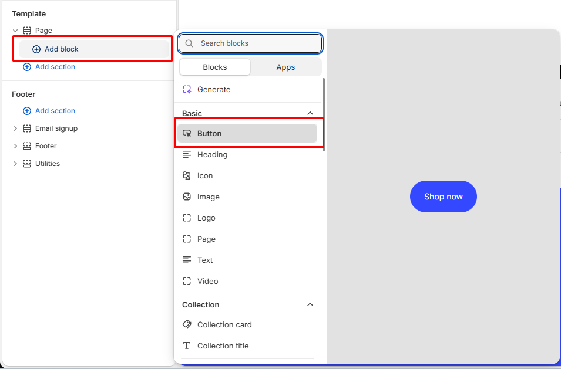

| Setting | Description |
| ------- | ----------- |
| Label | Sets the label. |
| Link | Sets the link destination. |
| Open link in new tab | Turn on to open link in new tab. |
| Style | Sets the style. Choose from Primary, Secondary, Link, or Custom. Edit primary and secondary button styles in theme settings. |
| Button colors |  |
| Background | Sets the button colors background. |
| Text | Sets the button colors text. |
| Borders | Sets the button colors borders. |
| Link text color | Sets the link text color. |
| Size |  |
| Desktop width | Sets the desktop width. Choose from Fit or Custom. |
| Custom width | Sets the custom width. Range: 0–100%. |
| Mobile width | Sets the mobile width. Choose from Fit or Custom. |

## Buy buttons

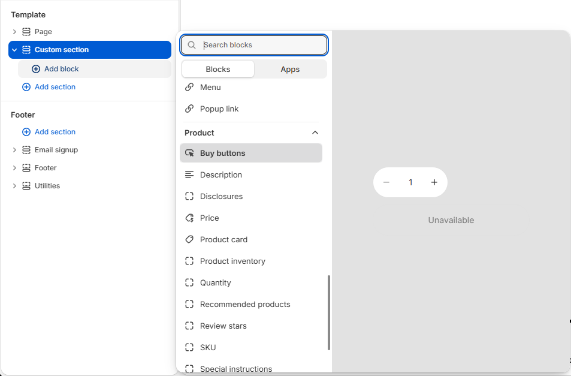

| Setting | Description |
| ------- | ----------- |
| Always stack buttons | Enables or disables always stack buttons. |
| Text color | Sets the text color. |
| Local pickup |  |
| Show pickup availability | Turn on to show pickup availability. |
| Gift card products |  |
| Gift card form | Enables or disables gift card form. |
| Button style | Sets the button style. Choose from Default or Custom. |
| Background | Sets the gift card products background color. |
| Text | Sets the gift card products text color. |
| Borders | Sets the gift card products borders color. |
| Selected button style | Sets the selected button style. Choose from Default or Custom. |
| Input style | Sets the input style. Choose from Input field or Custom. Edit input field in theme settings. |
| Border thickness | Sets the border thickness. Range: 0–4 px. |
| Corner radius | Sets the corner radius for gift card products. Range: 0–50 px. |
| Padding |  |
| Top | Sets the top padding. Range: 0–100 px. |
| Bottom | Sets the bottom padding. Range: 0–100 px. |
| Left | Sets the left padding. Range: 0–100 px. |
| Right | Sets the right padding. Range: 0–100 px. |

## Collection card

| Setting | Description |
| ------- | ----------- |
| Collection | Selects the collection to display. |
| Text |  |
| Placement | Sets the placement. Choose from On image or Below image. |
| Alignment | Sets the alignment for text. Choose from Left, Center, or Right. |
| Position | Sets the position for text. Choose from Top, Center, or Bottom. |
| Vertical gap | Sets the vertical gap. Range: 0–50 px. |
| Appearance |  |
| Background color | Sets the background color. |
| Borders |  |
| Style | Sets the style for borders. Choose from None or Solid. |
| Thickness | Sets the thickness for borders. Range: 0–100 px. |
| Opacity | Sets the opacity for borders. Range: 0–100%. |
| Color | Sets the color. |
| Corner radius | Sets the corner radius for borders. Range: 0–100 px. |

## Collection title

| Setting | Description |
| ------- | ----------- |
| Layout |  |
| Width | Sets the width for layout. Choose from Fit or Fill. |
| Max width | Sets the max width. Choose from Narrow, Normal, or None. |
| Alignment | Sets the alignment for layout. Choose from Left, Center, or Right. |
| Typography |  |
| Preset | Sets the preset for typography. Choose from Default, Paragraph, Heading 1, Heading 2, Heading 3, Heading 4, Heading 5, Heading 6, or Custom. Edit presets in theme settings. |
| Font | Sets the font for typography. Choose from Body, Subheading, Heading, or Accent. |
| Size | Sets the size for typography. Choose from Default, 10px, 12px, 14px, 16px, 18px, 20px, 24px, 32px, or 40px. |
| Line height | Sets the line height for typography. Choose from Tight, Normal, or Loose. |
| Letter spacing | Sets the letter spacing for typography. Choose from Tight, Normal, or Loose. |
| Case | Sets the case for typography. Choose from Default or Uppercase. |
| Wrap | Sets the wrap. Choose from Pretty, Balance, or None. |
| Appearance |  |
| Background | Enables or disables background. |
| Background color | Sets the background color. |
| Text color | Sets the text color. |
| Corner radius | Sets the corner radius for appearance. Range: 0–50. |
| Padding |  |
| Top | Sets the top padding. Range: 0–100 px. |
| Bottom | Sets the bottom padding. Range: 0–100 px. |
| Left | Sets the left padding. Range: 0–100 px. |
| Right | Sets the right padding. Range: 0–100 px. |

## Comparison slider

| Setting | Description |
| ------- | ----------- |
| Image 1 | Selects the image 1. |
| Image 2 | Selects the image 2. |
| Direction | Sets the direction. Choose from Horizontal or Vertical. |
| Text on images | Enables or disables text on images. |
| Text |  |
| Image 1 | Sets the image 1. |
| Image 2 | Sets the image 2. |
| Preset | Sets the preset for text. Choose from Default, Paragraph, Heading 1, Heading 2, Heading 3, Heading 4, Heading 5, or Heading 6. |
| Position | Sets the position for text. Choose from Top or Bottom. |
| Position | Sets the position for text. Choose from Left or Right. |
| Background | Enables or disables background. |
| Background color | Sets the background color. |
| Corner radius | Sets the corner radius for text. Range: 0–50. |
| Text color | Sets the text color. |
| Size |  |
| Aspect ratio | Sets the aspect ratio. Choose from Auto, Portrait, Square, or Landscape. |
| Desktop width | Sets the desktop width. Choose from Fit, Fill, or Custom. |
| Custom width | Sets the custom width. Range: 0–100%. |
| Mobile width | Sets the mobile width. Choose from Fit, Fill, or Custom. |
| Height | Sets the height for size. Choose from Fit or Fill. |
| Appearance |  |
| Slider color | Sets the slider color. |
| Slider inner color | Sets the slider inner color. |
| Border | Sets the border. Choose from None or Solid. |
| Thickness | Sets the thickness for appearance. Range: 0–100 px. |
| Opacity | Sets the opacity for appearance. Range: 0–100%. |
| Color | Sets the color. |
| Corner radius | Sets the corner radius for appearance. Range: 0–100 px. |
| Padding |  |
| Top | Sets the top padding. Range: 0–100 px. |
| Bottom | Sets the bottom padding. Range: 0–100 px. |
| Left | Sets the left padding. Range: 0–100 px. |
| Right | Sets the right padding. Range: 0–100 px. |

## Contact form

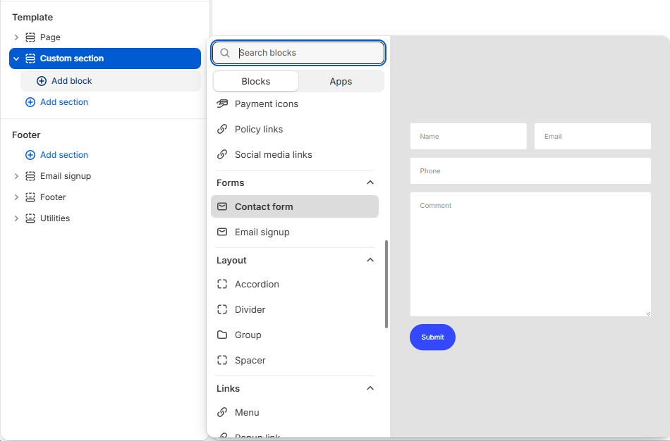

| Setting | Description |
| ------- | ----------- |
| Desktop width | Sets the desktop width. Choose from Fit or Custom. |
| Width | Sets the width. Range: 0–100%. |
| Mobile width | Sets the mobile width. Choose from Fit or Custom. |
| Appearance |  |
| Background color | Sets the background color. |
| Input |  |
| Style | Sets the style for input. Choose from Default or Custom. Edit input field in theme settings. |
| Background | Sets the input background color. |
| Text | Sets the input text color. |
| Borders | Sets the input borders color. |
| Border thickness | Sets the border thickness. Range: 0–4 px. |
| Corner radius | Sets the corner radius for input. Range: 0–50 px. |
| Padding |  |
| Top | Sets the top padding. Range: 0–100 px. |
| Bottom | Sets the bottom padding. Range: 0–100 px. |
| Left | Sets the left padding. Range: 0–100 px. |
| Right | Sets the right padding. Range: 0–100 px. |

## Submit button

| Setting | Description |
| ------- | ----------- |
| Label | Sets the label. |
| Style | Sets the style. Choose from Primary, Secondary, or Custom. Edit primary and secondary button styles in theme settings. |
| Button colors |  |
| Background | Sets the button colors background. |
| Text | Sets the button colors text. |
| Borders | Sets the button colors borders. |
| Size |  |
| Desktop width | Sets the desktop width. Choose from Fit or Custom. |
| Width | Sets the width for size. Range: 0–100%. |
| Mobile width | Sets the mobile width. Choose from Fit or Custom. |

## Custom Liquid

| Setting | Description |
| ------- | ----------- |
| Liquid code | Adds custom Liquid, HTML, or CSS code (liquid code). Add app snippets or other code to create advanced customizations. Learn more. |

## Disclosures

| Setting | Description |
| ------- | ----------- |
| Heading |  |
| Heading | Sets the heading. |
| Heading preset | Sets the heading preset. Choose from Default, Paragraph, Heading 1, Heading 2, Heading 3, Heading 4, Heading 5, or Heading 6. Edit presets in theme settings. |
| Disclosures |  |
| Open by default | Turn on to open by default. |
| Icon | Sets the icon for disclosures. Choose from Caret or Plus. |
| Title preset | Sets the title preset. Choose from Default, Paragraph, Heading 1, Heading 2, Heading 3, Heading 4, Heading 5, or Heading 6. Edit presets in theme settings. |
| Appearance |  |
| Text color | Sets the text color. |
| Dividers | Enables or disables dividers. |
| Divider color | Sets the divider color. |
| Padding |  |
| Top | Sets the top padding. Range: 0–100 px. |
| Bottom | Sets the bottom padding. Range: 0–100 px. |
| Left | Sets the left padding. Range: 0–100 px. |
| Right | Sets the right padding. Range: 0–100 px. |

## Email signup

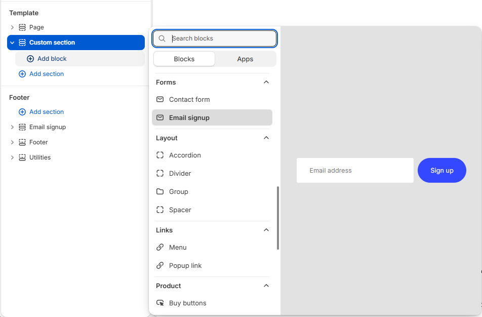

| Setting | Description |
| ------- | ----------- |
| Width | Sets the width. Choose from Fill or Custom. |
| Custom width | Sets the custom width. Range: 20–100%. |
| Heading |  |
| Text | Sets the text. |
| Color | Sets the color. |
| Text preset | Sets the text preset. Choose from Default, Paragraph, Heading 1, Heading 2, Heading 3, Heading 4, Heading 5, or Heading 6. Edit presets in theme settings. |
| Input |  |
| Border | Sets the border. Choose from All, Underline, or None. |
| Style | Sets the style for input. Choose from Default or Custom. Edit input field in theme settings. |
| Border thickness | Sets the border thickness. Range: 0–4 px. |
| Corner radius | Sets the corner radius for input. Range: 0–100 px. |
| Background | Sets the input background color. |
| Text | Sets the input text color. |
| Borders | Sets the input borders color. |
| Text preset | Sets the text preset. Choose from Default, Paragraph, Heading 1, Heading 2, Heading 3, Heading 4, Heading 5, or Heading 6. Edit presets in theme settings. |
| Submit button |  |
| Style | Sets the style for submit button. Choose from Primary, Secondary, Link, or Custom. Edit primary and secondary button styles in theme settings. |
| Button colors |  |
| Background | Sets the button colors background. |
| Text | Sets the button colors text. |
| Borders | Sets the button colors borders. |
| Link text color | Sets the link text color. |
| Display | Sets the display. Choose from Text or Arrow. |
| Label | Sets the label. |
| Integrated button | Enables or disables integrated button. |
| Text preset | Sets the text preset. Choose from Default, Paragraph, Heading 1, Heading 2, Heading 3, Heading 4, Heading 5, or Heading 6. Edit presets in theme settings. |
| Padding |  |
| Top | Sets the top padding. Range: 0–100 px. |
| Bottom | Sets the bottom padding. Range: 0–100 px. |
| Left | Sets the left padding. Range: 0–100 px. |
| Right | Sets the right padding. Range: 0–100 px. |

## Featured collection

| Setting | Description |
| ------- | ----------- |
| Collection | Selects the collection to display. |

## Filtering and sorting

| Setting | Description |
| ------- | ----------- |
| Filters | Enables or disables filters. Customize filters with the Search & Discovery app. |
| Direction | Sets the direction. Choose from Horizontal or Vertical. |
| Width | Sets the width. Choose from Page or Full. |
| Text label case | Sets the text label case. Choose from Default or Uppercase. |
| Text labels for swatches | Enables or disables text labels for swatches. |
| Text labels for applied filters | Enables or disables text labels for applied filters. |
| Sorting | Enables or disables sorting. |
| Grid layout control | Enables or disables grid layout control. |
| Appearance |  |
| Background color | Sets the background color. |
| Text color | Sets the text color. |
| Padding |  |
| Top | Sets the top padding. Range: 0–100 px. |
| Bottom | Sets the bottom padding. Range: 0–100 px. |
| Left | Sets the left padding. Range: 0–100 px. |
| Right | Sets the right padding. Range: 0–100 px. |
| Margin |  |
| Bottom | Sets the bottom for margin. Range: 0–100 px. |
| Right | Sets the right for margin. Range: 0–100 px. |

## Follow on Shop

| Setting | Description |
| ------- | ----------- |
| Padding |  |
| Top | Sets the top padding. Range: 0–100 px. |
| Bottom | Sets the bottom padding. Range: 0–100 px. |
| Left | Sets the left padding. Range: 0–100 px. |
| Right | Sets the right padding. Range: 0–100 px. |

## Copyright

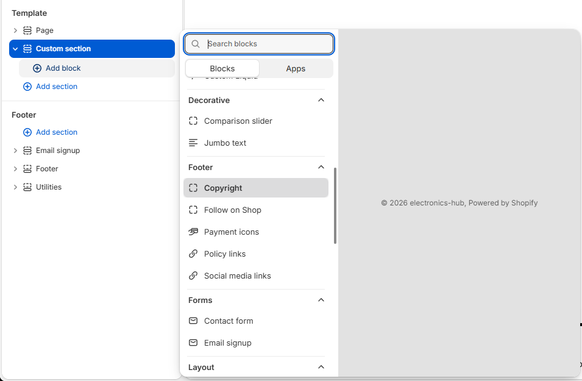

| Setting | Description |
| ------- | ----------- |
| Show "Powered by Shopify" | Turn on to show "Powered by Shopify". |
| Appearance |  |
| Text color | Sets the text color. |
| Size | Sets the size for appearance. Choose from 10px, 12px, 14px, 16px, or 18px. |
| Case | Sets the case for appearance. Choose from Default or Uppercase. |

## Policy links

| Setting | Description |
| ------- | ----------- |
| Appearance |  |
| Text color | Sets the text color. |
| Size | Sets the size for appearance. Choose from 10px, 12px, 14px, 16px, or 18px. |
| Case | Sets the case for appearance. Choose from Default or Uppercase. |

## Group

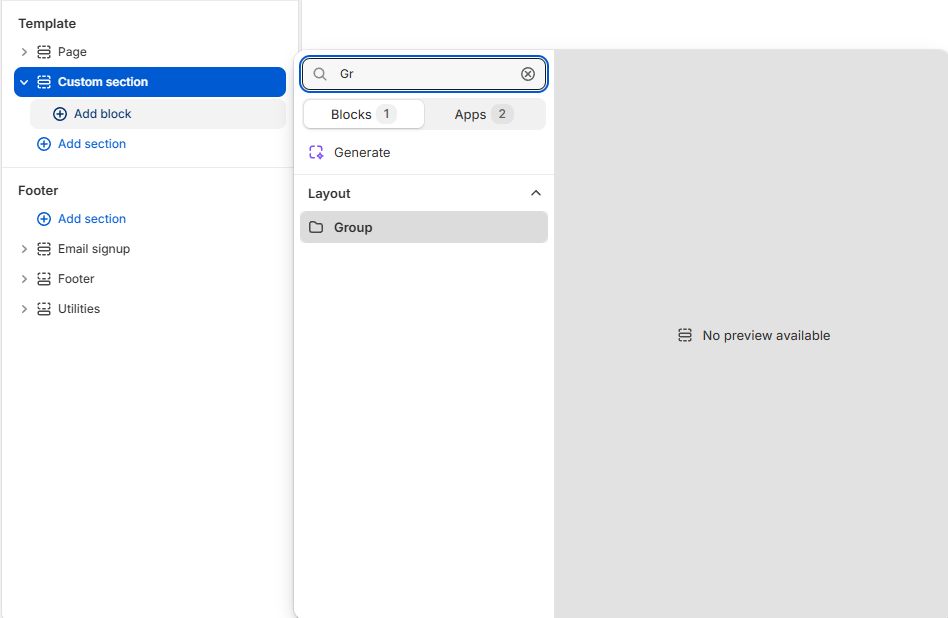

| Setting | Description |
| ------- | ----------- |
| Layout |  |
| Direction | Sets the direction for layout. Choose from Vertical or Horizontal. |
| Vertical on mobile | Enables or disables vertical on mobile. |
| Alignment | Sets the alignment for layout. Choose from Left, Center, Right, or Space between. |
| Position | Sets the position for layout. Choose from Top, Center, or Bottom. |
| Align text baseline | Turn on to align text baseline. |
| Alignment | Sets the alignment for layout. Choose from Left, Center, or Right. |
| Position | Sets the position for layout. Choose from Top, Center, Bottom, or Space between. |
| Gap | Sets the gap for layout. Range: 0–100 px. |
| Size |  |
| Width | Sets the width for size. Choose from Fit, Fill, or Custom. |
| Custom width | Sets the custom width. Range: 0–100%. |
| Mobile width | Sets the mobile width. Choose from Fit, Fill, or Custom. |
| Height | Sets the height for size. Choose from Fit, Fill, or Custom. |
| Custom height | Sets the custom height. Range: 0–100%. |
| Appearance |  |
| Background media | Sets the background media. Choose from None, Image, or Video. |
| Background color | Sets the background color. |
| Video | Selects the uploaded video. |
| Video position | Sets the video position. Choose from Cover or Contain. |
| Image | Selects the image. |
| Image position | Sets the image position. Choose from Cover or Fit. |
| Background overlay | Enables or disables background overlay. |
| Overlay color | Sets the overlay color. |
| Overlay style | Sets the overlay style. Choose from Solid or Gradient. |
| Gradient direction | Sets the gradient direction. Choose from Up or Down. |
| Borders |  |
| Style | Sets the style for borders. Choose from None or Solid. |
| Thickness | Sets the thickness for borders. Range: 0–100 px. |
| Opacity | Sets the opacity for borders. Range: 0–100%. |
| Color | Sets the color. |
| Corner radius | Sets the corner radius for borders. Range: 0–100 px. |
| Block link |  |
| Link | Sets the link destination. |
| Open link in new tab | Turn on to open link in new tab. |
| Image | Sets the image. |
| Padding |  |
| Top | Sets the top padding. Range: 0–100 px. |
| Bottom | Sets the bottom padding. Range: 0–100 px. |
| Left | Sets the left padding. Range: 0–100 px. |
| Right | Sets the right padding. Range: 0–100 px. |

## Icon

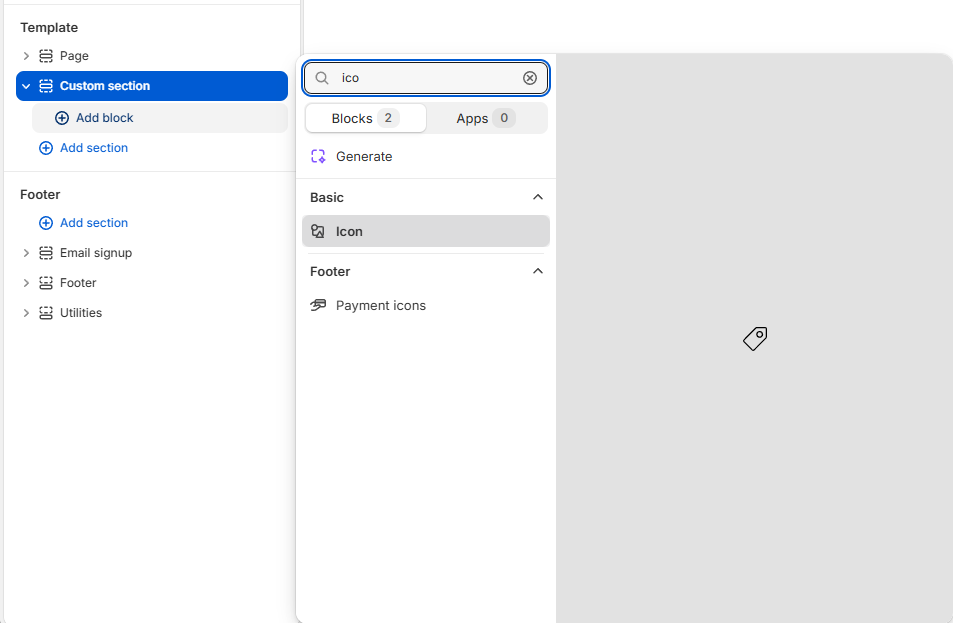

| Setting | Description |
| ------- | ----------- |
| Icon | Sets the icon. Choose from None, Apple, Arrow, Banana, Bottle, Box, Carrot, Chat bubble, Check box, or Clipboard. |
| Image icon | Selects the image icon. |
| Width | Sets the width. Range: 12–200 px. |
| Link | Sets the link destination. |
| Open link in new tab | Turn on to open link in new tab. |
| Color | Sets the color. |

## Image

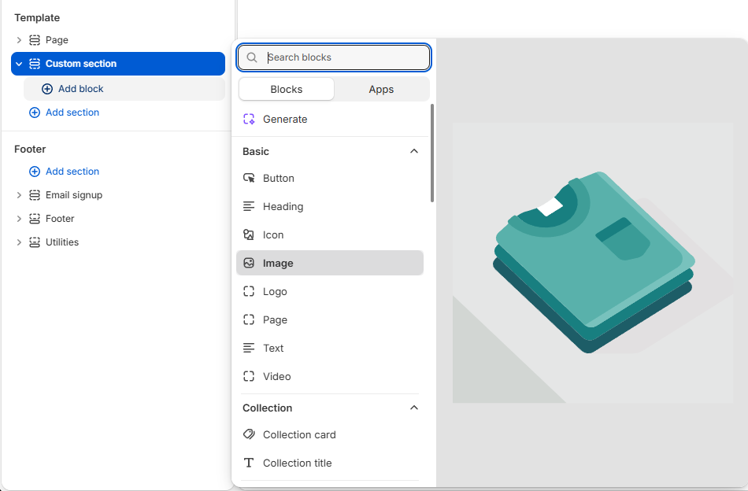

| Setting | Description |
| ------- | ----------- |
| Image | Selects the image. |
| Link | Sets the link destination. |
| Size |  |
| Aspect ratio | Sets the aspect ratio. Choose from Auto, Portrait, Square, or Landscape. |
| Desktop width | Sets the desktop width. Choose from Fit, Fill, or Custom. |
| Custom width | Sets the custom width. Range: 0–100%. |
| Mobile width | Sets the mobile width. Choose from Fit, Fill, or Custom. |
| Height | Sets the height for size. Choose from Fit or Fill. |
| Borders |  |
| Style | Sets the style for borders. Choose from None or Solid. |
| Thickness | Sets the thickness for borders. Range: 0–100 px. |
| Opacity | Sets the opacity for borders. Range: 0–100%. |
| Color | Sets the color. |
| Corner radius | Sets the corner radius for borders. Range: 0–100 px. |
| Padding |  |
| Top | Sets the top padding. Range: 0–100 px. |
| Bottom | Sets the bottom padding. Range: 0–100 px. |
| Left | Sets the left padding. Range: 0–100 px. |
| Right | Sets the right padding. Range: 0–100 px. |

## Jumbo text

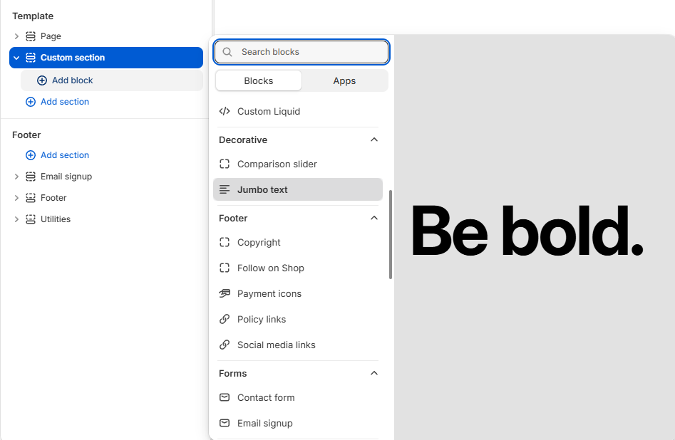

| Setting | Description |
| ------- | ----------- |
| Text | Sets the text. |
| Font | Sets the font. Choose from Body, Subheading, Heading, or Accent. |
| Alignment | Sets the alignment. Choose from Left, Center, or Right. |
| Line height | Sets the line height. Choose from Tight, Normal, or Loose. |
| Letter spacing | Sets the letter spacing. Choose from Tight, Normal, or Loose. |
| Case | Sets the case. Choose from Default or Uppercase. |
| Animation | Sets the animation. Choose from None, Blur, or Reveal. |
| Repeat animation | Enables or disables repeat animation. |
| Appearance |  |
| Text color | Sets the text color. |

## Logo

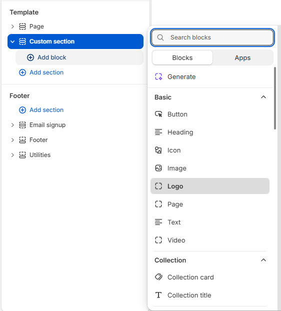

| Setting | Description |
| ------- | ----------- |
| Use inverse logo | Turn on to use inverse logo. |
| Font | Sets the font. Choose from Body, Subheading, Heading, or Accent. |
| Color | Sets the color. |
| Size |  |
| Unit | Sets the unit. Choose from Pixel or Percent. |
| Width | Sets the width for size. Range: 10–100%. |
| Height | Sets the height for size. Range: 16–320 px. |
| Custom mobile size | Enables or disables custom mobile size. |
| Mobile size |  |
| Width | Sets the width for mobile size. Range: 10–100%. |
| Height | Sets the height for mobile size. Range: 16–160 px. |
| Padding |  |
| Top | Sets the top padding. Range: 0–100 px. |
| Bottom | Sets the bottom padding. Range: 0–100 px. |
| Left | Sets the left padding. Range: 0–100 px. |
| Right | Sets the right padding. Range: 0–100 px. |

## Menu

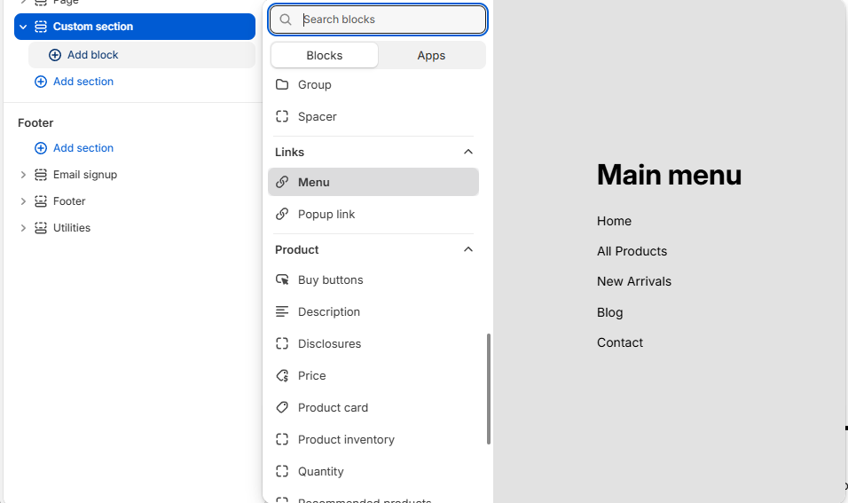

| Setting | Description |
| ------- | ----------- |
| Menu | Selects the menu to display. |
| Heading | Sets the heading. |
| Appearance |  |
| Vertical gap | Sets the vertical gap. Range: 0–50 px. |
| Show as accordion on mobile | Turn on to show as accordion on mobile. |
| Icon | Sets the icon for appearance. Choose from Caret or Plus. |
| Dividers | Enables or disables dividers. |
| Background color | Sets the background color. |
| Text color | Sets the text color. |
| Typography |  |
| Heading preset | Sets the heading preset. Choose from Default, Paragraph, Heading 1, Heading 2, Heading 3, Heading 4, Heading 5, or Heading 6. |
| Link preset | Sets the link preset. Choose from Default, Paragraph, Heading 1, Heading 2, Heading 3, Heading 4, Heading 5, or Heading 6. |
| Padding |  |
| Top | Sets the top padding. Range: 0–100 px. |
| Bottom | Sets the bottom padding. Range: 0–100 px. |
| Left | Sets the left padding. Range: 0–100 px. |
| Right | Sets the right padding. Range: 0–100 px. |

## Page

| Setting | Description |
| ------- | ----------- |
| Page | Selects the page to display. |
| Max width | Sets the max width. Choose from Narrow, Normal, or None. |
| Appearance |  |
| Background color | Sets the background color. |
| Text color | Sets the text color. |
| Padding |  |
| Top | Sets the top padding. Range: 0–100 px. |
| Bottom | Sets the bottom padding. Range: 0–100 px. |
| Left | Sets the left padding. Range: 0–100 px. |
| Right | Sets the right padding. Range: 0–100 px. |

## Content

| Setting | Description |
| ------- | ----------- |
| Text color | Sets the text color. |

## Payment icons

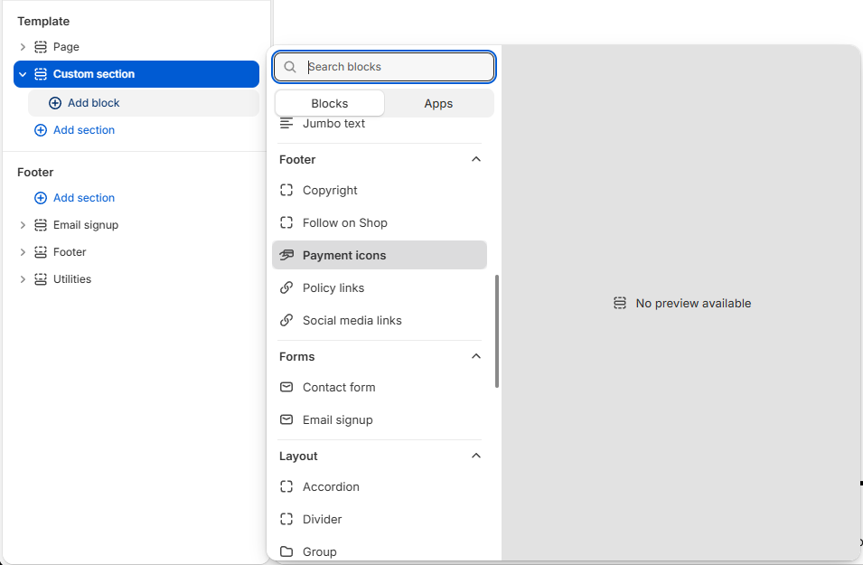

| Setting | Description |
| ------- | ----------- |
| Alignment | Sets the alignment. Choose from Left, Center, Right, or Space between. |
| Gap | Sets the gap. Range: 0–100 px. |
| Padding |  |
| Top | Sets the top padding. Range: 0–100 px. |
| Bottom | Sets the bottom padding. Range: 0–100 px. |
| Left | Sets the left padding. Range: 0–100 px. |
| Right | Sets the right padding. Range: 0–100 px. |

## Popup link

| Setting | Description |
| ------- | ----------- |
| Popup |  |
| Behavior | Sets the behavior. Choose from Default or Drawer. |
| Link |  |
| Text | Sets the text. |
| Preset | Sets the preset for link. Choose from Default, Paragraph, Heading 1, Heading 2, Heading 3, Heading 4, Heading 5, or Heading 6. Edit presets in theme settings. |
| Link padding |  |
| Top | Sets the top for link padding. Range: 0–100 px. |
| Bottom | Sets the bottom for link padding. Range: 0–100 px. |
| Left | Sets the left for link padding. Range: 0–100 px. |
| Right | Sets the right for link padding. Range: 0–100 px. |

## Price

| Setting | Description |
| ------- | ----------- |
| Show sale price first | Turn on to show sale price first. |
| Installments | Enables or disables installments. |
| Tax information | Enables or disables tax information. |
| Typography |  |
| Preset | Sets the preset for typography. Choose from Default, Paragraph, Heading 1, Heading 2, Heading 3, Heading 4, Heading 5, Heading 6, or Custom. Edit presets in theme settings. |
| Width | Sets the width for typography. Choose from Fit or Fill. |
| Alignment | Sets the alignment for typography. Choose from Left, Center, or Right. |
| Font | Sets the font for typography. Choose from Body, Subheading, Heading, or Accent. |
| Size | Sets the size for typography. Choose from Default, 10px, 12px, 14px, 16px, 18px, 20px, 24px, 32px, or 40px. |
| Line height | Sets the line height for typography. Choose from Tight, Normal, or Loose. |
| Letter spacing | Sets the letter spacing for typography. Choose from Tight, Normal, or Loose. |
| Case | Sets the case for typography. Choose from Default or Uppercase. |
| Appearance |  |
| Text color | Sets the text color. |
| Padding |  |
| Top | Sets the top padding. Range: 0–100 px. |
| Bottom | Sets the bottom padding. Range: 0–100 px. |
| Left | Sets the left padding. Range: 0–100 px. |
| Right | Sets the right padding. Range: 0–100 px. |

## Product card

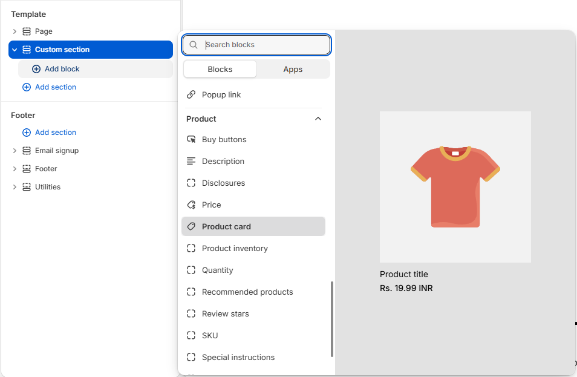

| Setting | Description |
| ------- | ----------- |
| Product | Selects the product to display. |
| Vertical gap | Sets the vertical gap. Range: 0–50 px. |
| Size |  |
| Desktop width | Sets the desktop width. Choose from Fit, Fill, or Custom. |
| Custom width | Sets the custom width. Range: 0–100%. |
| Mobile width | Sets the mobile width. Choose from Fit, Fill, or Custom. |
| Appearance |  |
| Background color | Sets the background color. |
| Style | Sets the style for appearance. Choose from None or Solid. |
| Thickness | Sets the thickness for appearance. Range: 0–100 px. |
| Opacity | Sets the opacity for appearance. Range: 0–100%. |
| Color | Sets the color. |
| Corner radius | Sets the corner radius for appearance. Range: 0–32 px. |
| Padding |  |
| Top | Sets the top padding. Range: 0–50 px. |
| Bottom | Sets the bottom padding. Range: 0–50 px. |
| Left | Sets the left padding. Range: 0–50 px. |
| Right | Sets the right padding. Range: 0–50 px. |

## Special instructions

| Setting | Description |
| ------- | ----------- |
| Heading | Sets the heading. |
| Description | Sets the description. |
| Property name | Sets the property name. Cannot be blank and must be unique for each block. Shows in cart, checkout, and order details. |
| Buyer input |  |
| Input type | Sets the input type. Choose from Text or Checkbox. |
| Max characters | Sets the max characters. Range: 25–250. |
| Checkbox label | Sets the checkbox label. |
| Input required to add item to cart | Enables or disables input required to add item to cart. |
| Placeholder text | Sets the placeholder text. |
| Padding |  |
| Top | Sets the top padding. Range: 0–100 px. |
| Bottom | Sets the bottom padding. Range: 0–100 px. |
| Left | Sets the left padding. Range: 0–100 px. |
| Right | Sets the right padding. Range: 0–100 px. |

## Text

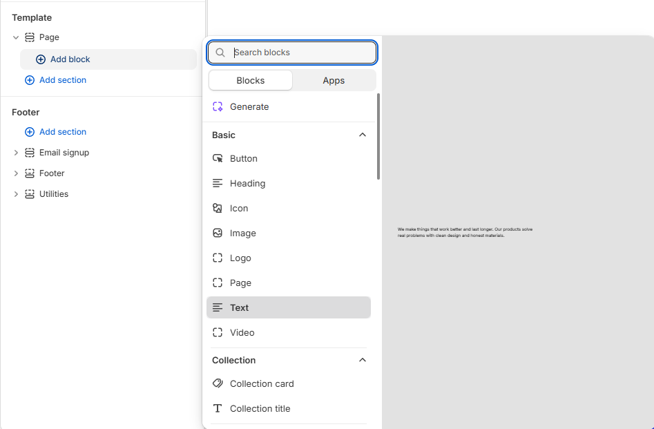

| Setting | Description |
| ------- | ----------- |
| Text | Sets the text. Supports basic formatting. |
| Layout |  |
| Width | Sets the width for layout. Choose from Fit or Fill. |
| Max width | Sets the max width. Choose from Narrow, Normal, or None. |
| Alignment | Sets the alignment for layout. Choose from Left, Center, or Right. |
| Typography |  |
| Preset | Sets the preset for typography. Choose from Default, Paragraph, Heading 1, Heading 2, Heading 3, Heading 4, Heading 5, Heading 6, or Custom. Edit presets in theme settings. |
| Font | Sets the font for typography. Choose from Body, Subheading, Heading, or Accent. |
| Size | Sets the size for typography. Choose from Default, 10px, 12px, 14px, 16px, 18px, 20px, 24px, 32px, or 40px. |
| Line height | Sets the line height for typography. Choose from Tight, Normal, or Loose. |
| Letter spacing | Sets the letter spacing for typography. Choose from Tight, Normal, or Loose. |
| Case | Sets the case for typography. Choose from Default or Uppercase. |
| Wrap | Sets the wrap. Choose from Pretty, Balance, or None. |
| Appearance |  |
| Text color | Sets the text color. |
| Background | Enables or disables background. |
| Background color | Sets the background color. |
| Corner radius | Sets the corner radius for appearance. Range: 0–50. |
| Padding |  |
| Top | Sets the top padding. Range: 0–100 px. |
| Bottom | Sets the bottom padding. Range: 0–100 px. |
| Left | Sets the left padding. Range: 0–100 px. |
| Right | Sets the right padding. Range: 0–100 px. |

## Product inventory

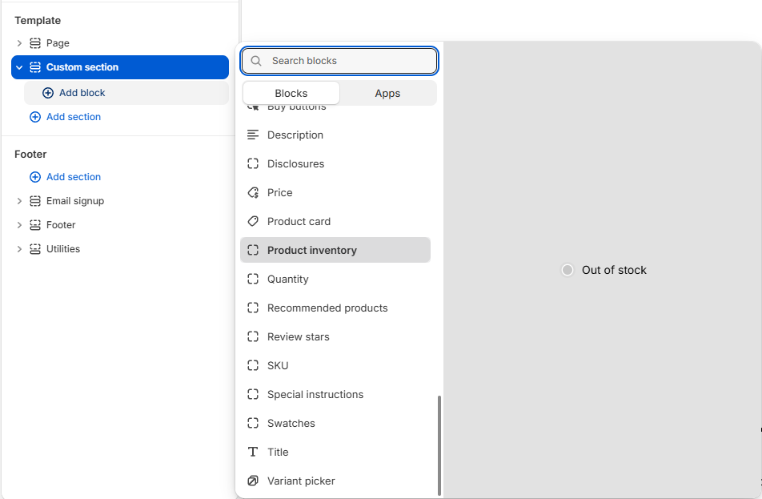

| Setting | Description |
| ------- | ----------- |
| Low stock threshold | Sets the low stock threshold. Range: 0–100. |
| Show low stock quantity | Turn on to show low stock quantity. |
| Appearance |  |
| Text color | Sets the text color. |
| Padding |  |
| Top | Sets the top padding. Range: 0–100 px. |
| Bottom | Sets the bottom padding. Range: 0–100 px. |
| Left | Sets the left padding. Range: 0–100 px. |
| Right | Sets the right padding. Range: 0–100 px. |

## Recommended products

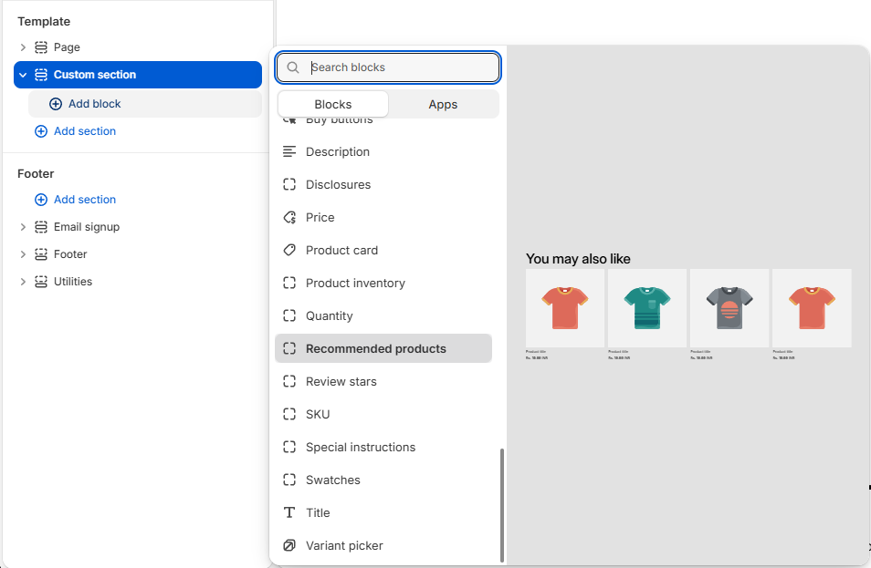

| Setting | Description |
| ------- | ----------- |
| Type | Sets the type. Choose from Related or Complementary. |
| Cards layout |  |
| Style | Sets the style for cards layout. Choose from Grid or Carousel. |
| Carousel on mobile | Enables or disables carousel on mobile. |
| Product count | Sets the product count. Range: 2–10. |
| Horizontal gap | Sets the horizontal gap. Range: 0–100 px. |
| Vertical gap | Sets the vertical gap. Range: 0–100 px. |
| Carousel navigation |  |
| Icon | Sets the icon for carousel navigation. Choose from Arrows, Chevrons, Large arrows, Large chevrons, or None. |
| Icon background | Sets the icon background. Choose from None, Circle, or Square. |
| Layout |  |
| Gap | Sets the gap for layout. Range: 0–100 px. |
| Corner radius | Sets the corner radius for layout. Range: 0–32 px. |
| Background color | Sets the background color. |
| Padding |  |
| Top | Sets the top padding. Range: 0–100 px. |
| Bottom | Sets the bottom padding. Range: 0–100 px. |
| Left | Sets the left padding. Range: 0–100 px. |
| Right | Sets the right padding. Range: 0–100 px. |

## Product title

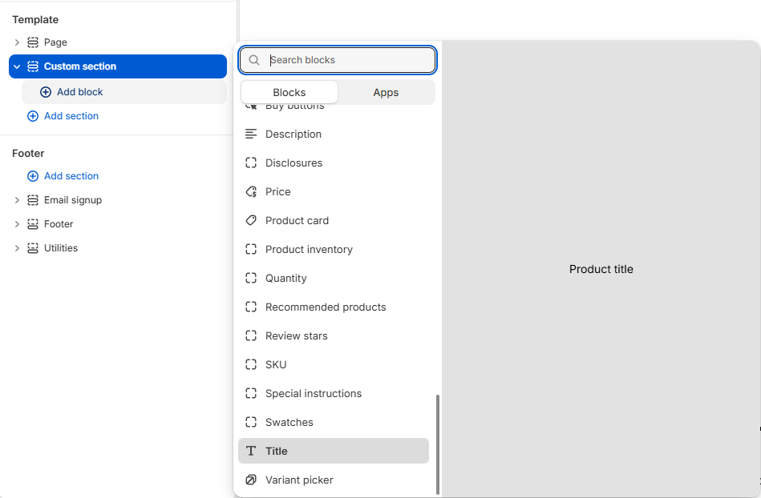

| Setting | Description |
| ------- | ----------- |
| Layout |  |
| Width | Sets the width for layout. Choose from Fit or Fill. |
| Max width | Sets the max width. Choose from Narrow, Normal, or None. |
| Alignment | Sets the alignment for layout. Choose from Left, Center, or Right. |
| Typography |  |
| Preset | Sets the preset for typography. Choose from Default, Paragraph, Heading 1, Heading 2, Heading 3, Heading 4, Heading 5, Heading 6, or Custom. Edit presets in theme settings. |
| Font | Sets the font for typography. Choose from Body, Subheading, Heading, or Accent. |
| Size | Sets the size for typography. Choose from Default, 10px, 12px, 14px, 16px, 18px, 20px, 24px, 32px, or 40px. |
| Line height | Sets the line height for typography. Choose from Tight, Normal, or Loose. |
| Letter spacing | Sets the letter spacing for typography. Choose from Tight, Normal, or Loose. |
| Case | Sets the case for typography. Choose from Default or Uppercase. |
| Wrap | Sets the wrap. Choose from Pretty, Balance, or None. |
| Appearance |  |
| Text color | Sets the text color. |
| Background | Enables or disables background. |
| Background color | Sets the background color. |
| Corner radius | Sets the corner radius for appearance. Range: 0–50. |
| Padding |  |
| Top | Sets the top padding. Range: 0–100 px. |
| Bottom | Sets the bottom padding. Range: 0–100 px. |
| Left | Sets the left padding. Range: 0–100 px. |
| Right | Sets the right padding. Range: 0–100 px. |

## Quantity

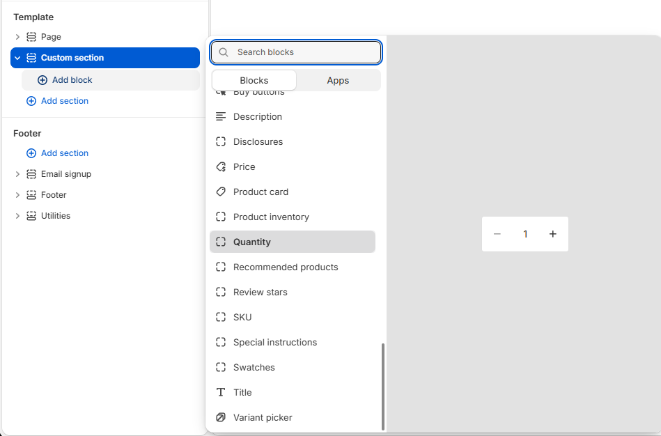

| Setting | Description |
| ------- | ----------- |
| Input |  |
| Style | Sets the style for input. Choose from Default or Custom. Edit input field in theme settings. |
| Background | Sets the input background color. |
| Text | Sets the input text color. |
| Borders | Sets the input borders color. |
| Border thickness | Sets the border thickness. Range: 0–4 px. |
| Corner radius | Sets the corner radius for input. Range: 0–50 px. |

## Review stars

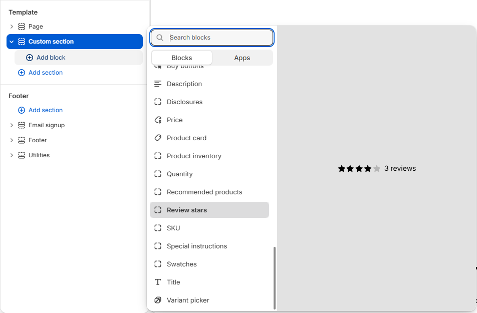

| Setting | Description |
| ------- | ----------- |
| Style | Sets the style. Choose from Outline, Shaded, or Single. |
| Review count | Enables or disables review count. |
| Text color | Sets the text color. |
| Typography |  |
| Preset | Sets the preset for typography. Choose from Paragraph, Heading 1, Heading 2, Heading 3, Heading 4, Heading 5, or Heading 6. |
| Width | Sets the width for typography. Choose from Fit or Fill. |
| Alignment | Sets the alignment for typography. Choose from Left, Center, or Right. |

## SKU

| Setting | Description |
| ------- | ----------- |
| Typography |  |
| Preset | Sets the preset for typography. Choose from Default, Paragraph, Heading 1, Heading 2, Heading 3, Heading 4, Heading 5, Heading 6, or Custom. Edit presets in theme settings. |
| Width | Sets the width for typography. Choose from Fit or Fill. |
| Alignment | Sets the alignment for typography. Choose from Left, Center, or Right. |
| Font | Sets the font for typography. Choose from Body, Subheading, Heading, or Accent. |
| Size | Sets the size for typography. Choose from Default, 10px, 12px, 14px, 16px, 18px, 20px, 24px, 32px, or 40px. |
| Line height | Sets the line height for typography. Choose from Tight, Normal, or Loose. |
| Letter spacing | Sets the letter spacing for typography. Choose from Tight, Normal, or Loose. |
| Case | Sets the case for typography. Choose from Default or Uppercase. |
| Padding |  |
| Top | Sets the top padding. Range: 0–100 px. |
| Bottom | Sets the bottom padding. Range: 0–100 px. |
| Left | Sets the left padding. Range: 0–100 px. |
| Right | Sets the right padding. Range: 0–100 px. |

## Social media links

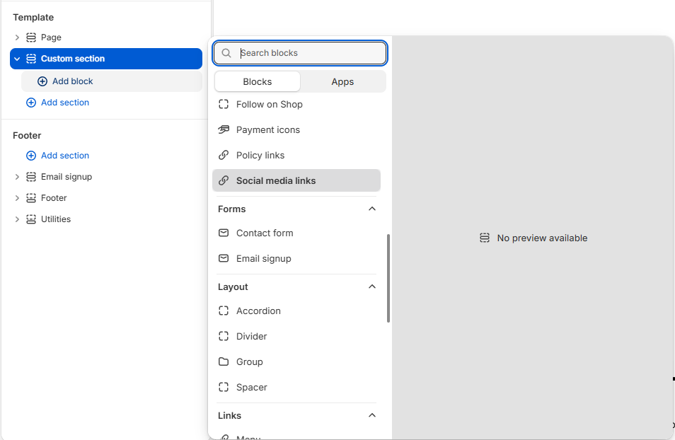

| Setting | Description |
| ------- | ----------- |
| Appearance |  |
| Color | Sets the color. |
| Links |  |
| Facebook | Sets the facebook destination. |
| Instagram | Sets the instagram destination. |
| YouTube | Sets the youTube destination. |
| TikTok | Sets the tikTok destination. |
| X (Twitter) | Sets the x (Twitter) destination. |
| Threads | Sets the threads destination. |
| LinkedIn | Sets the linkedIn destination. |
| Bluesky | Sets the bluesky destination. |
| Snapchat | Sets the snapchat destination. |
| Pinterest | Sets the pinterest destination. |
| Tumblr | Sets the tumblr destination. |
| Vimeo | Sets the vimeo destination. |
| Custom link | Sets the custom link destination. |

## Spacer

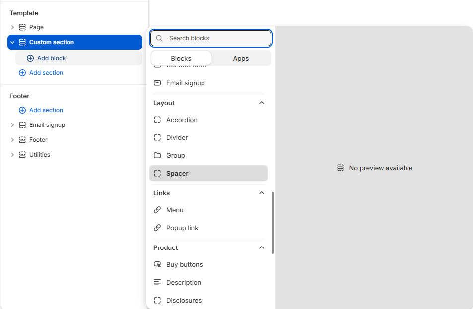

| Setting | Description |
| ------- | ----------- |
| Unit | Sets the unit. Choose from Pixel or Percent. |
| Size | Sets the size. Range: 0–100%. |
| Size | Sets the size. Range: 0–400 px. |
| Custom mobile size | Enables or disables custom mobile size. |
| Mobile size |  |
| Size | Sets the size for mobile size. Range: 0–100%. |
| Size | Sets the size for mobile size. Range: 0–400 px. |

## Swatches

| Setting | Description |
| ------- | ----------- |
| Alignment | Sets the alignment. Choose from Left, Center, or Right. |
| Mobile alignment | Sets the mobile alignment. Choose from Left, Center, or Right. |
| Padding |  |
| Hide padding | Turn on to hide padding. |
| Top | Sets the top padding. Range: 0–50 px. |
| Bottom | Sets the bottom padding. Range: 0–50 px. |
| Left | Sets the left padding. Range: 0–50 px. |
| Right | Sets the right padding. Range: 0–50 px. |

## Text

| Setting | Description |
| ------- | ----------- |
| Text | Sets the text. Supports basic formatting. |
| Layout |  |
| Width | Sets the width for layout. Choose from Fit or Fill. |
| Max width | Sets the max width. Choose from Narrow, Normal, or None. |
| Alignment | Sets the alignment for layout. Choose from Left, Center, or Right. |
| Typography |  |
| Preset | Sets the preset for typography. Choose from Default, Paragraph, Heading 1, Heading 2, Heading 3, Heading 4, Heading 5, Heading 6, or Custom. Edit presets in theme settings. |
| Font | Sets the font for typography. Choose from Body, Subheading, Heading, or Accent. |
| Size | Sets the size for typography. Choose from Default, 10px, 12px, 14px, 16px, 18px, 20px, 24px, 32px, or 40px. |
| Line height | Sets the line height for typography. Choose from Tight, Normal, or Loose. |
| Letter spacing | Sets the letter spacing for typography. Choose from Tight, Normal, or Loose. |
| Case | Sets the case for typography. Choose from Default or Uppercase. |
| Wrap | Sets the wrap. Choose from Pretty, Balance, or None. |
| Appearance |  |
| Text color | Sets the text color. |
| Background | Enables or disables background. |
| Background color | Sets the background color. |
| Corner radius | Sets the corner radius for appearance. Range: 0–50. |
| Padding |  |
| Top | Sets the top padding. Range: 0–100 px. |
| Bottom | Sets the bottom padding. Range: 0–100 px. |
| Left | Sets the left padding. Range: 0–100 px. |
| Right | Sets the right padding. Range: 0–100 px. |

## Variant picker

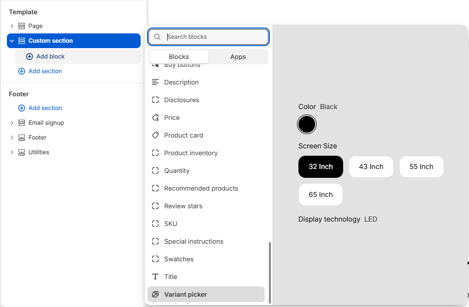

| Setting | Description |
| ------- | ----------- |
| Type |  |
| Style | Sets the style for type. Choose from Dropdowns or Buttons. |
| Swatches | Enables or disables swatches. |
| Appearance |  |
| Text color | Sets the text color. |
| Variant style | Sets the variant style. Choose from Default or Custom. Edit variant styling in theme settings. |
| Background | Sets the background color. |
| Text | Sets the text color. |
| Borders | Sets the borders color. |
| Selected variant style | Sets the selected variant style. Choose from Default or Custom. |
| Alignment | Sets the alignment for appearance. Choose from Left, Center, or Right. |
| Padding |  |
| Top | Sets the top padding. Range: 0–100 px. |
| Bottom | Sets the bottom padding. Range: 0–100 px. |
| Left | Sets the left padding. Range: 0–100 px. |
| Right | Sets the right padding. Range: 0–100 px. |

## Video

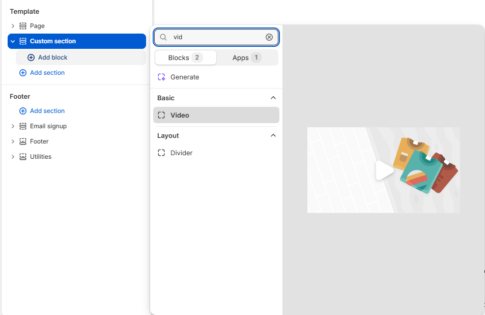

| Setting | Description |
| ------- | ----------- |
| Source | Sets the source. Choose from Uploaded or External URL. |
| Video | Selects the uploaded video. |
| URL | Adds the URL (YouTube or Vimeo). Use a YouTube or Vimeo URL. |
| Autoplay | Enables or disables autoplay. Videos will be muted by default. |
| Loop video | Turn on to loop video. |
| Cover image | Selects the cover image. |
| Alt text | Sets the alt text. Describe the video for assistive tech users. |
| Size |  |
| Width | Sets the width for size. Range: 0–100%. |
| Mobile width | Sets the mobile width. Range: 0–100%. |
| Aspect ratio | Sets the aspect ratio. Choose from Auto, Portrait, Square, or Landscape. |
| Borders |  |
| Style | Sets the style for borders. Choose from None or Solid. |
| Thickness | Sets the thickness for borders. Range: 0–100 px. |
| Opacity | Sets the opacity for borders. Range: 0–100%. |
| Color | Sets the color. |
| Corner radius | Sets the corner radius for borders. Range: 0–100 px. |
| Padding |  |
| Top | Sets the top padding. Range: 0–32 px. |
| Bottom | Sets the bottom padding. Range: 0–32 px. |
| Left | Sets the left padding. Range: 0–32 px. |
| Right | Sets the right padding. Range: 0–32 px. |
