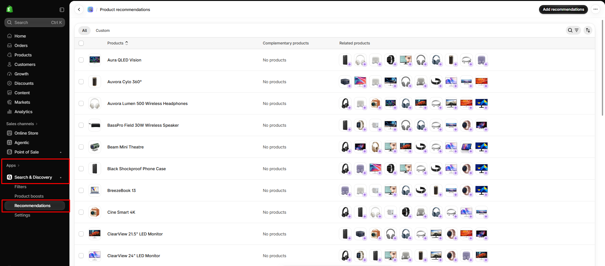

# Complementary products

Show products that pair well with the one a customer is viewing, such as a case with a phone.

## How to access

1. **Go to** Shopify Admin → Apps → **Search & Discovery**.
2. Open **Recommendations**. The table lists every product with its **Complementary products** and **Related products**.
3. Click **Add recommendations** (or open a product row) and choose the products that go with it.
4. Click **Save**.

## How to show them on the product page

1. **Go to** Shopify Admin → Online Store → Themes → **Customize**.
2. Open **Products → Default product**.
3. Select the **Related product** (Recommended products) section.
4. Set **Type** to **Complementary**.

Complementary recommendations only appear for products where you have set them in Search & Discovery.
