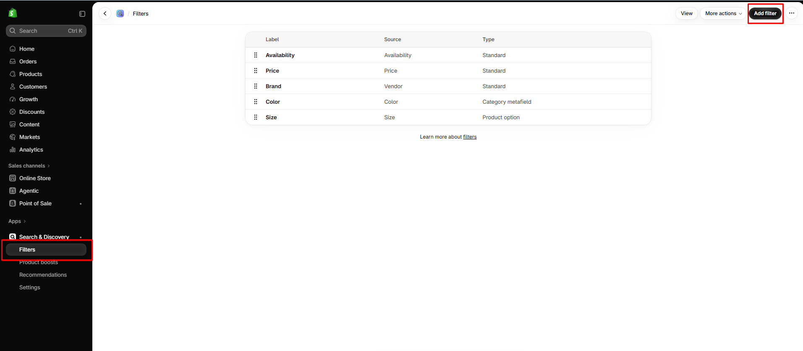

# Filters

Let customers narrow collection and search results by color, price, availability, and more.

## How to access

1. **Go to** Shopify Admin → Apps → **Search & Discovery**.
2. Open **Filters**.
3. Click **Add filter** and choose what to filter by (for example Product type, Availability, Price, or a product option such as Color).
4. Click **Save**.

The filters appear on collection and search pages through the **Filters** block, which you can style in the theme editor.

## How to access the theme settings

1. **Go to** Shopify Admin → Online Store → Themes.
2. **Click** Customize on your active theme.
3. Open **Products → Default collection** (or **Search**), select **Collection** (or **Search results**), and then the **Filters** block.

### Filters block settings

| Setting | Description |
| ------- | ----------- |
| Filters | Enables or disables filters. Customize filters with the Search & Discovery app. |
| Direction | Sets the direction. Choose from Horizontal or Vertical. |
| Width | Sets the width. Choose from Page or Full. |
| Text label case | Sets the text label case. Choose from Default or Uppercase. |
| Text labels for swatches | Enables or disables text labels for swatches. |
| Text labels for applied filters | Enables or disables text labels for applied filters. |
| Sorting | Enables or disables sorting. |
| Grid layout control | Enables or disables grid layout control. |
| Appearance |  |
| Background color | Sets the background color. |
| Text color | Sets the text color. |
| Padding |  |
| Top | Sets the top padding. Range: 0–100 px. |
| Bottom | Sets the bottom padding. Range: 0–100 px. |
| Left | Sets the left padding. Range: 0–100 px. |
| Right | Sets the right padding. Range: 0–100 px. |
| Margin |  |
| Bottom | Sets the bottom for margin. Range: 0–100 px. |
| Right | Sets the right for margin. Range: 0–100 px. |

## Filters on this store

| Label        | Source       | Type               |
| ------------ | ------------ | ------------------ |
| Availability | Availability | Standard           |
| Price        | Price        | Standard           |
| Brand        | Vendor       | Standard           |
| Color        | Color        | Category metafield |
| Size         | Size         | Product option     |


The filter list itself (which filters exist and their order) is managed in Shopify Search & Discovery, not in the theme. Color filters use the same swatch data as product pages.

