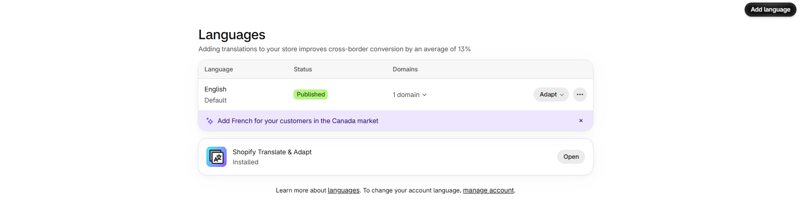

# Language translation

Translate your store content and theme text into other languages.

## How to access

1. **Go to** Shopify Admin → Settings → **Languages**.
2. Click **Add language** and choose the language to add.
3. Click **Translate** next to a language to translate products, collections, pages, and theme content (use the **Translate & Adapt** app for easier editing).
4. **Publish** the language when it is ready.

## Theme text

The theme ships with translations for 34 languages, so built-in labels such as "Add to cart" and "Search" appear in the customer's language. To change a built-in label:

1. **Go to** Shopify Admin → Online Store → Themes.
2. Click the **three-dot menu** on the theme → **Edit default theme content**.
3. Search for the text, edit it, and click **Save**.

## Language and country selectors

The header can show a language selector and a country/region selector. See [Header](../header/header.md) → **Localization** to turn them on or off and to style them. Which languages and countries appear depends on your Shopify **Markets** settings.
