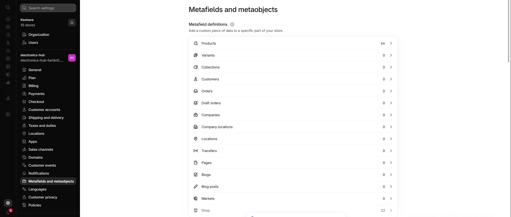
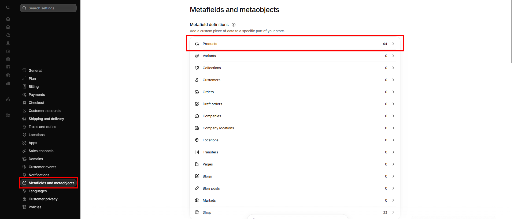
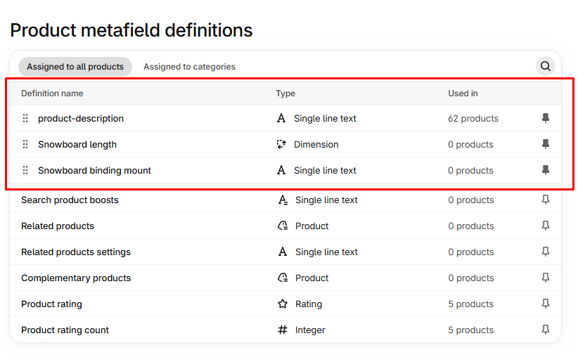
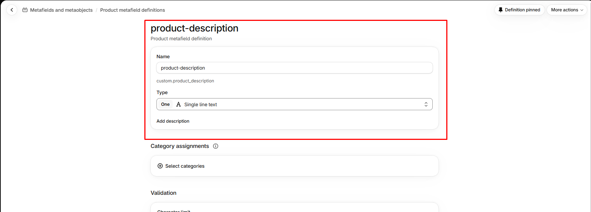

# Metafields

Metafields store extra product data that the theme can display. The Electronics Hub theme reads the metafields below.

| Metafield | Used for |
| --------- | -------- |
| `custom.product_description` | Product description text shown in the **Featured product information** section on the home page. |
| `shopify.disclosure` | Legal or compliance text shown by the **Disclosures** block on the product page. |
| `reviews.rating` | Average rating shown by the Judge.me review badge and used in structured data. |
| `reviews.rating_count` | Number of reviews shown beside the rating. |

## How to create a metafield definition

1. **Go to** Shopify Admin → **Settings** → **Metafields and metaobjects**.
2. Click **Products** → **Add definition**.
3. Enter a **Name**. The namespace and key are generated (for example `custom.product_description`).
4. Choose the **Type** (for example Rich text or Multi-line text) and click **Save**.

## How to fill a metafield

1. **Go to** Shopify Admin → Products and open a product.
2. Scroll to the **Metafields** section.
3. Enter the value and click **Save**.

## How to show a metafield in the theme

1. Open the theme editor and select a text block.
2. In the text field, click the **Insert dynamic source** icon.
3. Choose the product metafield.


The `reviews.*` metafields are created and filled by the Judge.me app. Do not edit them manually.

