# Theme settings

Control the logo, colors, typography, buttons, cards, cart, and other styles used throughout your storefront.

## How to access

1. **Go to** Shopify Admin → Online Store → Themes.
2. **Click** Customize on your active theme.
3. Click **Theme settings** (the paint-brush icon) in the sidebar, then open the group you need.

## Logo and favicon

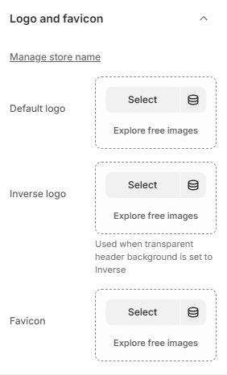

| Setting | Description |
| ------- | ----------- |
| Default logo | Selects the default logo. |
| Inverse logo | Selects the inverse logo. Used when transparent header background is set to Inverse. |
| Desktop height | Sets the desktop height. Range: 12–100 px. Only affects header logo. |
| Mobile height | Sets the mobile height. Range: 12–100 px. Only affects header logo. |
| Favicon | Selects the favicon. |

## Color palette

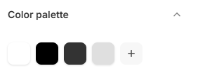

| Setting | Description |
| ------- | ----------- |
| Color palette | Defines the base colors used across the store. |


The store palette is Background `#FFFFFF`, Foreground `#000000`, Color 1 `#333333`, Color 2 `#DFDFDF`. Most other color settings reference these four values, so changing one updates everything that uses it.


## Typography

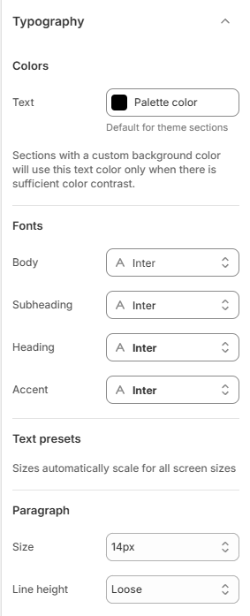

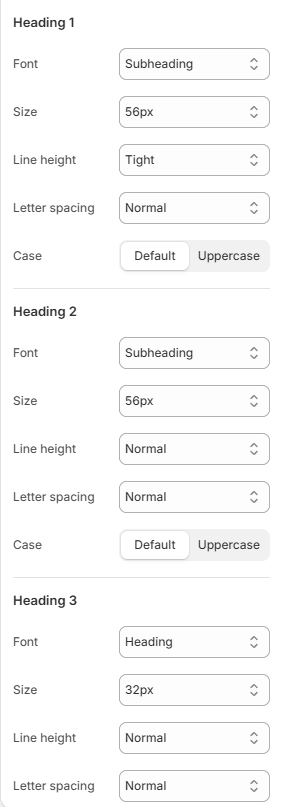

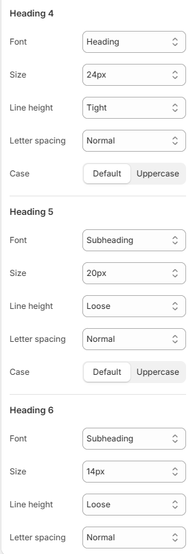

| Setting | Description |
| ------- | ----------- |
| Colors |  |
| Text | Sets the text color. Default for theme sections. |
| Fonts |  |
| Body | Selects the body font. |
| Subheading | Selects the subheading font. |
| Heading | Selects the heading font. |
| Accent | Selects the accent font. |
| Text presets |  |
| Paragraph |  |
| Size | Sets the size for paragraph. Choose from 10px, 12px, 14px, 16px, or 18px. |
| Line height | Sets the line height for paragraph. Choose from Tight, Normal, or Loose. |
| Heading 1 |  |
| Font | Sets the font for heading 1. Choose from Heading, Accent, Subheading, or Body. |
| Size | Sets the size for heading 1. Choose from 10px, 12px, 14px, 16px, 18px, 20px, 24px, 32px, 40px, or 48px. |
| Line height | Sets the line height for heading 1. Choose from Tight, Normal, or Loose. |
| Letter spacing | Sets the letter spacing for heading 1. Choose from Tight, Normal, or Loose. |
| Case | Sets the case for heading 1. Choose from Default or Uppercase. |
| Heading 2 |  |
| Font | Sets the font for heading 2. Choose from Heading, Accent, Subheading, or Body. |
| Size | Sets the size for heading 2. Choose from 10px, 12px, 14px, 16px, 18px, 20px, 24px, 32px, 40px, or 48px. |
| Line height | Sets the line height for heading 2. Choose from Tight, Normal, or Loose. |
| Letter spacing | Sets the letter spacing for heading 2. Choose from Tight, Normal, or Loose. |
| Case | Sets the case for heading 2. Choose from Default or Uppercase. |
| Heading 3 |  |
| Font | Sets the font for heading 3. Choose from Heading, Accent, Subheading, or Body. |
| Size | Sets the size for heading 3. Choose from 10px, 12px, 14px, 16px, 18px, 20px, 24px, 32px, 40px, or 48px. |
| Line height | Sets the line height for heading 3. Choose from Tight, Normal, or Loose. |
| Letter spacing | Sets the letter spacing for heading 3. Choose from Tight, Normal, or Loose. |
| Case | Sets the case for heading 3. Choose from Default or Uppercase. |
| Heading 4 |  |
| Font | Sets the font for heading 4. Choose from Heading, Accent, Subheading, or Body. |
| Size | Sets the size for heading 4. Choose from 10px, 12px, 14px, 16px, 18px, 20px, 24px, 32px, 40px, or 48px. |
| Line height | Sets the line height for heading 4. Choose from Tight, Normal, or Loose. |
| Letter spacing | Sets the letter spacing for heading 4. Choose from Tight, Normal, or Loose. |
| Case | Sets the case for heading 4. Choose from Default or Uppercase. |
| Heading 5 |  |
| Font | Sets the font for heading 5. Choose from Heading, Accent, Subheading, or Body. |
| Size | Sets the size for heading 5. Choose from 10px, 12px, 14px, 16px, 18px, 20px, 24px, 32px, 40px, or 48px. |
| Line height | Sets the line height for heading 5. Choose from Tight, Normal, or Loose. |
| Letter spacing | Sets the letter spacing for heading 5. Choose from Tight, Normal, or Loose. |
| Case | Sets the case for heading 5. Choose from Default or Uppercase. |
| Heading 6 |  |
| Font | Sets the font for heading 6. Choose from Heading, Accent, Subheading, or Body. |
| Size | Sets the size for heading 6. Choose from 10px, 12px, 14px, 16px, 18px, 20px, 24px, 32px, 40px, or 48px. |
| Line height | Sets the line height for heading 6. Choose from Tight, Normal, or Loose. |
| Letter spacing | Sets the letter spacing for heading 6. Choose from Tight, Normal, or Loose. |
| Case | Sets the case for heading 6. Choose from Default or Uppercase. |

## Page

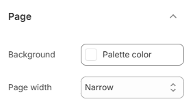

| Setting | Description |
| ------- | ----------- |
| Background | Sets the background color. |
| Page width | Sets the page width. Choose from Narrow, Normal, or Wide. |

## Animations

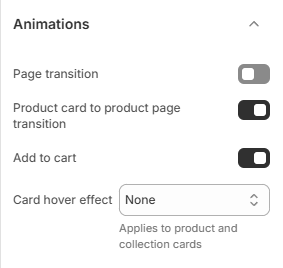

| Setting | Description |
| ------- | ----------- |
| Page transition | Enables or disables page transition. |
| Product card to product page transition | Enables or disables product card to product page transition. |
| Add to cart | Enables or disables the add-to-cart animation. |
| Card hover effect | Sets the card hover effect. Choose from None, Lift, Scale, or Zoom. Applies to product and collection cards. |

## Badges

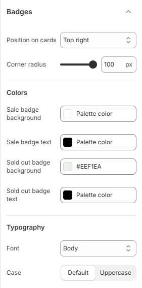

| Setting | Description |
| ------- | ----------- |
| Position on cards | Sets the position on cards. Choose from Bottom left, Top left, or Top right. |
| Corner radius | Sets the corner radius. Range: 0–100 px. |
| Colors |  |
| Sale badge background | Sets the sale badge background color. |
| Sale badge text | Sets the sale badge text color. |
| Sold out badge background | Sets the sold out badge background color. |
| Sold out badge text | Sets the sold out badge text color. |
| Typography |  |
| Font | Sets the font for typography. Choose from Body, Subheading, Heading, or Accent. |
| Case | Sets the case for typography. Choose from Default or Uppercase. |

## Buttons

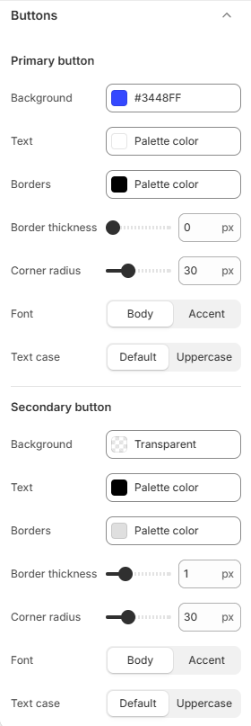

| Setting | Description |
| ------- | ----------- |
| Primary button |  |
| Background | Sets the primary button background color. |
| Text | Sets the primary button text color. |
| Borders | Sets the primary button borders color. |
| Border thickness | Sets the border thickness. Range: 0–4 px. |
| Corner radius | Sets the corner radius for primary button. Range: 0–100 px. |
| Font | Sets the font for primary button. Choose from Body or Accent. |
| Text case | Sets the text case. Choose from Default or Uppercase. |
| Secondary button |  |
| Background | Sets the secondary button background color. |
| Text | Sets the secondary button text color. |
| Borders | Sets the secondary button borders color. |
| Border thickness | Sets the border thickness. Range: 0–4 px. |
| Corner radius | Sets the corner radius for secondary button. Range: 0–100 px. |
| Font | Sets the font for secondary button. Choose from Body or Accent. |
| Text case | Sets the text case. Choose from Default or Uppercase. |
| Pills |  |
| Corner radius | Sets the corner radius for pills. Range: 0–40 px. |

## Cart

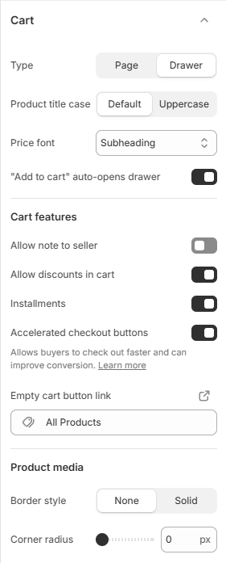

| Setting | Description |
| ------- | ----------- |
| Type | Sets the type. Choose from Page or Drawer. |
| Product title case | Sets the product title case. Choose from Default or Uppercase. |
| Price font | Sets the price font. Choose from Body, Subheading, Heading, or Accent. |
| "Add to cart" auto-opens drawer | Enables or disables "Add to cart" auto-opens drawer. |
| Cart features |  |
| Allow note to seller | Turn on to allow note to seller. |
| Open note to seller by default | Turn on to open note to seller by default. |
| Allow discounts in cart | Turn on to allow discounts in cart. |
| Installments | Enables or disables installments. |
| Accelerated checkout buttons | Enables or disables accelerated checkout buttons. Allows buyers to check out faster and can improve conversion. Learn more. |
| Empty cart button link | Sets the empty cart button link destination. |
| Product media |  |
| Border style | Sets the border style. Choose from None or Solid. |
| Border thickness | Sets the border thickness. Range: 0–10 px. |
| Border opacity | Sets the border opacity. Range: 0–100%. |
| Corner radius | Sets the corner radius for product media. Range: 0–100 px. |

## Drawers

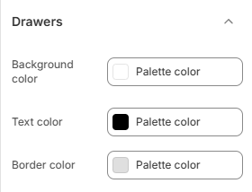

| Setting | Description |
| ------- | ----------- |
| Background color | Sets the background color. |
| Text color | Sets the text color. |
| Border color | Sets the border color. |

## Icons

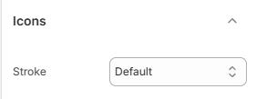

| Setting | Description |
| ------- | ----------- |
| Stroke | Sets the stroke. Choose from Thin, Default, or Heavy. |

## Input fields

| Setting | Description |
| ------- | ----------- |
| Background | Sets the background color. |
| Text | Sets the text color. |
| Borders | Sets the borders color. |
| Border thickness | Sets the border thickness. Range: 0–4 px. |
| Corner radius | Sets the corner radius. Range: 0–32 px. |
| Text preset | Sets the text preset. Choose from Default, Paragraph, Heading 1, Heading 2, Heading 3, Heading 4, Heading 5, or Heading 6. |

## Popovers and modals

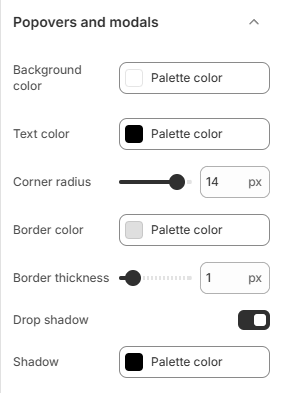

| Setting | Description |
| ------- | ----------- |
| Background color | Sets the background color. |
| Text color | Sets the text color. |
| Corner radius | Sets the corner radius. Range: 0–16 px. |
| Border color | Sets the border color. |
| Border thickness | Sets the border thickness. Range: 0–10 px. |
| Drop shadow | Enables or disables drop shadow. |
| Shadow | Sets the shadow color. |

## Prices

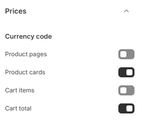

| Setting | Description |
| ------- | ----------- |
| Currency code |  |
| Product pages | Displays the currency code next to prices on product pages. |
| Product cards | Displays the currency code next to prices on product cards. |
| Cart items | Displays the currency code next to prices on cart items. |
| Cart total | Displays the currency code next to prices on cart total. |

## Product cards

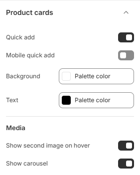

| Setting | Description |
| ------- | ----------- |
| Quick add | Enables or disables quick add. |
| Mobile quick add | Enables or disables mobile quick add. |
| Background | Sets the background color. |
| Text | Sets the text color. |
| Media |  |
| Show second image on hover | Turn on to show second image on hover. |
| Show carousel | Turn on to show carousel. |

## Search

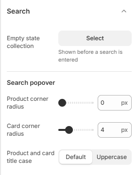

| Setting | Description |
| ------- | ----------- |
| Empty state collection | Selects the collection to display. Shown before a search is entered. |
| Search popover |  |
| Product corner radius | Sets the product corner radius. Range: 0–32 px. |
| Card corner radius | Sets the card corner radius. Range: 0–16 px. |
| Product and card title case | Sets the product and card title case. Choose from Default or Uppercase. |

## Swatches

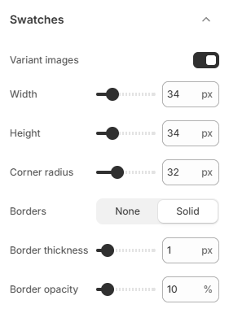

| Setting | Description |
| ------- | ----------- |
| Variant images | Enables or disables variant images. |
| Width | Sets the width. Range: 16–100 px. |
| Height | Sets the height. Range: 16–100 px. |
| Corner radius | Sets the corner radius. Range: 0–100 px. |
| Borders | Sets the borders. Choose from None or Solid. |
| Border thickness | Sets the border thickness. Range: 0–10 px. |
| Border opacity | Sets the border opacity. Range: 0–100%. |


When **Show variant image** is on, swatches display the variant's own photo instead of the option's color or image swatch. If a variant has no image, the swatch can appear empty. On this store the setting is **on**.


## Variant pickers

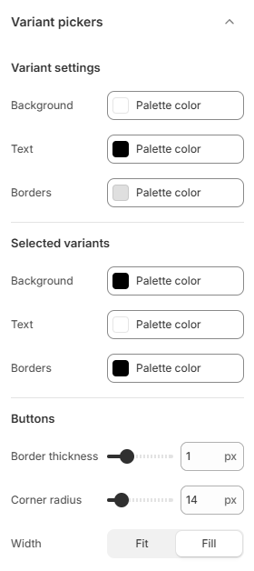

| Setting | Description |
| ------- | ----------- |
| Variant settings |  |
| Background | Sets the variant settings background color. |
| Text | Sets the variant settings text color. |
| Borders | Sets the variant settings borders color. |
| Selected variants |  |
| Background | Sets the selected variants background color. |
| Text | Sets the selected variants text color. |
| Borders | Sets the selected variants borders color. |
| Buttons |  |
| Border thickness | Sets the border thickness. Range: 0–4 px. |
| Corner radius | Sets the corner radius for buttons. Range: 0–100 px. |
| Width | Sets the width for buttons. Choose from Fit or Fill. |
