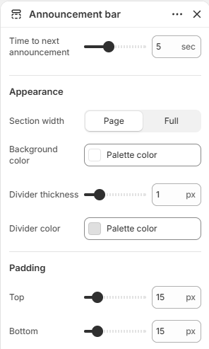
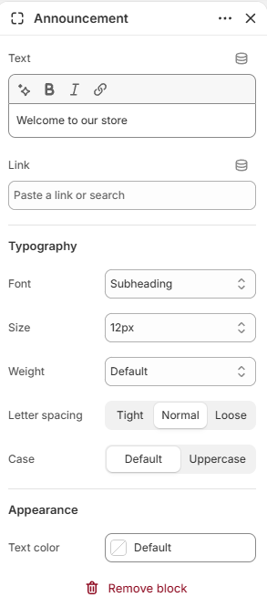

# Announcement bar

Displays rotating announcements above the header.

## How to access

1. **Go to** Shopify Admin → Online Store → Themes.
2. **Click** Customize on your active theme.
3. Open the **Header** group in the sidebar and select **Announcement bar**.

### Section Settings

| Setting | Description |
| ------- | ----------- |
| Time to next announcement | Sets the time to next announcement. Range: 2–10 sec. |
| Appearance |  |
| Section width | Sets the section width. Choose from Page or Full. |
| Background color | Sets the background color. |
| Divider thickness | Sets the divider thickness. Range: 0–5 px. |
| Divider color | Sets the divider color. |
| Padding |  |
| Top | Sets the top padding. Range: 0–100 px. |
| Bottom | Sets the bottom padding. Range: 0–100 px. |

### Blocks

Add blocks to this section in the theme editor. Each block is a separate item you can add, remove, and reorder.

#### Announcement

Displays an announcement message in the announcement bar.

| Setting | Description |
| ------- | ----------- |
| Text | Sets the text. |
| Link | Sets the link destination. |
| Typography |  |
| Font | Sets the font for typography. Choose from Body, Subheading, Heading, or Accent. |
| Size | Sets the size for typography. Choose from Default, 10px, 12px, 14px, 16px, 18px, 20px, 24px, 32px, or 40px. |
| Weight | Sets the weight for typography. Choose from Default, Thin, Light, Regular, Medium, Semibold, Bold, or Black. |
| Letter spacing | Sets the letter spacing for typography. Choose from Tight, Normal, or Loose. |
| Case | Sets the case for typography. Choose from Default or Uppercase. |
| Appearance |  |
| Text color | Sets the text color. |
