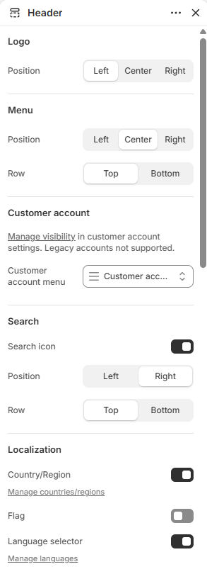
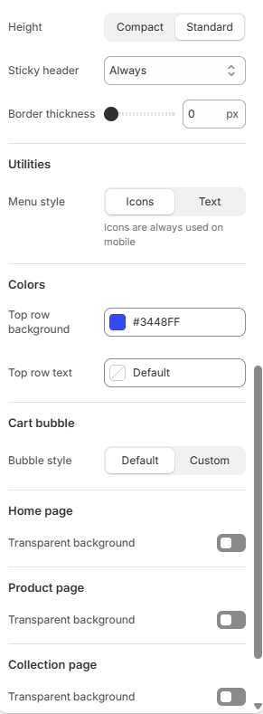
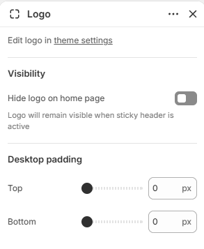
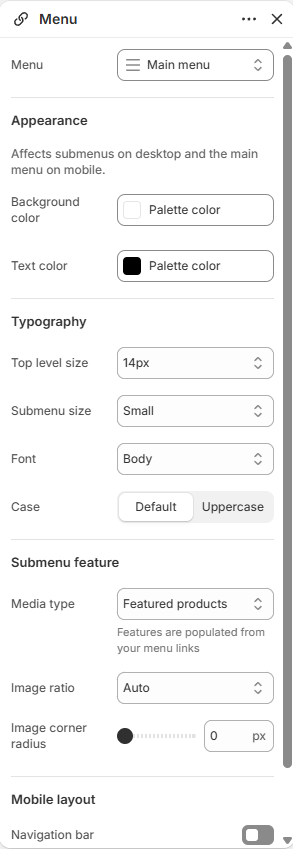

# Header

Displays the logo, main menu, search, account, cart, and country or language selectors.

## How to access

1. **Go to** Shopify Admin → Online Store → Themes.
2. **Click** Customize on your active theme.
3. Open the **Header** group in the sidebar and select **Header**.

### Section Settings

| Setting | Description |
| ------- | ----------- |
| Logo |  |
| Position | Sets the position for logo. Choose from Left, Center, or Right. |
| Menu |  |
| Position | Sets the position for menu. Choose from Left, Center, or Right. |
| Row | Sets the row for menu. Choose from Top or Bottom. |
| Customer account |  |
| Customer account menu | Selects the menu to display. |
| Search |  |
| Search icon | Enables or disables search icon. |
| Position | Sets the position for search. Choose from Left or Right. |
| Row | Sets the row for search. Choose from Top or Bottom. |
| Localization |  |
| Country/Region | Enables or disables country/Region. Manage countries/regions. |
| Flag | Enables or disables flag. |
| Language selector | Enables or disables language selector. Manage languages. |
| Font | Sets the font for localization. Choose from Heading, Subheading, Body, or Accent. |
| Size | Sets the size for localization. Choose from 10px, 12px, 14px, 16px, or 18px. |
| Position | Sets the position for localization. Choose from Left or Right. |
| Row | Sets the row for localization. Choose from Top or Bottom. |
| Appearance |  |
| Width | Sets the width for appearance. Choose from Page or Full. |
| Height | Sets the height for appearance. Choose from Compact or Standard. |
| Sticky header | Sets the sticky header. Choose from Always, On scroll up, or Never. |
| Divider thickness | Sets the divider thickness. Range: 0–5 px. |
| Divider width | Sets the divider width. Choose from Page or Full. |
| Divider color | Sets the divider color. |
| Border thickness | Sets the border thickness. Range: 0–5 px. |
| Bottom border color | Sets the bottom border color. |
| Utilities |  |
| Menu style | Sets the menu style. Choose from Icons or Text. Icons are always used on mobile. |
| Size | Sets the size for utilities. Choose from 12px, 14px, 16px, or 18px. |
| Font | Sets the font for utilities. Choose from Heading, Subheading, Body, or Accent. |
| Case | Sets the case for utilities. Choose from Default or Uppercase. |
| Colors |  |
| Top row background | Sets the top row background color. |
| Top row text | Sets the top row text color. |
| Bottom row background | Sets the bottom row background color. |
| Bottom row text | Sets the bottom row text color. |
| Cart bubble |  |
| Bubble style | Sets the bubble style. Choose from Default or Custom. |
| Background | Sets the cart bubble background color. |
| Text | Sets the cart bubble text color. |
| Home page |  |
| Transparent background | Enables or disables transparent background. |
| Inverse logo | Enables or disables inverse logo. |
| Transparent header text | Sets the home page transparent header text color. |
| Product page |  |
| Transparent header text | Sets the product page transparent header text color. |
| Collection page |  |
| Transparent header text | Sets the collection page transparent header text color. |

### Blocks

Add blocks to this section in the theme editor. Each block is a separate item you can add, remove, and reorder.

#### Logo

Displays the store logo in the header.

| Setting | Description |
| ------- | ----------- |
| Visibility |  |
| Hide logo on home page | Turn on to hide logo on home page. Logo will remain visible when sticky header is active. |
| Desktop padding |  |
| Top | Sets the top for desktop padding. Range: 0–100 px. |
| Bottom | Sets the bottom for desktop padding. Range: 0–100 px. |

#### Menu

Displays the main navigation menu in the header.

| Setting | Description |
| ------- | ----------- |
| Menu | Selects the menu to display. |
| Appearance |  |
| Background color | Sets the background color. |
| Text color | Sets the text color. |
| Typography |  |
| Top level size | Sets the top level size. Choose from 10px, 12px, 14px, 16px, or 18px. |
| Submenu size | Sets the submenu size. Choose from Small, Medium, or Large. |
| Font | Sets the font for typography. Choose from Body, Subheading, Heading, or Accent. |
| Case | Sets the case for typography. Choose from Default or Uppercase. |
| Submenu feature |  |
| Media type | Sets the media type. Choose from None, Collection images, Featured products, or Featured collections. Features are populated from your menu links. |
| Image ratio | Sets the image ratio. Choose from Auto, Portrait, or Square. |
| Image ratio | Sets the image ratio. Choose from Auto, Landscape, or Square. |
| Image corner radius | Sets the image corner radius. Range: 0–32 px. |
| Mobile layout |  |
| Navigation bar | Enables or disables navigation bar. |
| Navigation bar background color | Sets the navigation bar background color. |
| Navigation bar text color | Sets the navigation bar text color. |
| Accordion | Enables or disables accordion. |
| Expand first group | Turn on to expand first group. |
| Dividers | Enables or disables dividers. |
