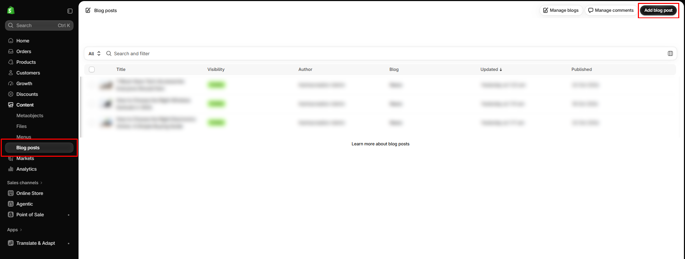

# How to create a blog post

Publish an article that can appear on the blog page and in the [Blog posts](../sections/featured-blog-posts.md) section.

## How to access

1. **Go to** Shopify Admin → **Content** → **Blog posts**.
2. Click **Add blog post**.
3. Enter the **Title** and **Content**.
4. Add a **Featured image** and an **Excerpt**.
5. Under **Blog**, choose the blog (this store uses the `news` blog).
6. Click **Save**.

