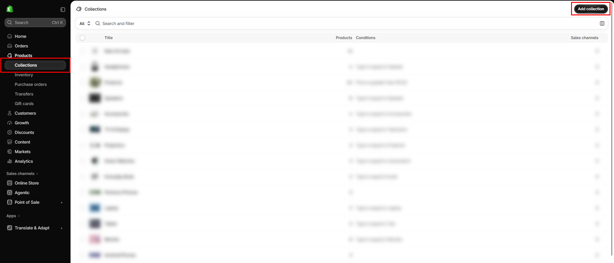

# How to create a collection

Group products so customers can browse them together.

## How to access

1. **Go to** Shopify Admin → **Products** → **Collections**.
2. Click **Add collection**.
3. Enter a **Title** and **Description**, and add a **Collection image**.
4. Choose a **Collection type**:
   * **Manual**: you pick each product.
   * **Smart**: products are added automatically using conditions (for example Product type is Laptop).
5. Click **Save**.

To show the collection in the theme, select it in a section such as [Collection list](../sections/collection-list.md) or [Featured collection](../sections/product-list.md).


Changing a collection title changes what shoppers see. Changing its URL handle changes the link, so Shopify offers to create a redirect.


