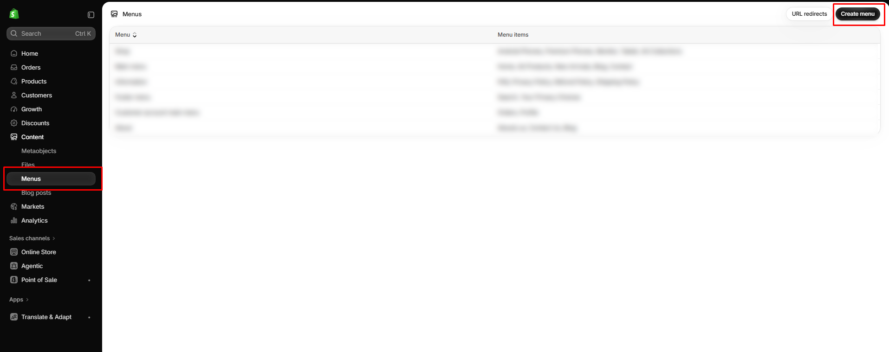

# How to create a menu

Build the navigation shown in the header and footer.

## How to access

1. **Go to** Shopify Admin → **Content** → **Menus**.
2. Click **Create menu** and enter a **Title**.
3. Click **Add menu item**, enter a name, and choose where it links (collection, product, page, or URL).
4. Drag items to reorder them, or nest an item under another to create a dropdown.
5. Click **Save**.

## Menus used on this store

| Menu | Used in |
| ---- | ------- |
| `main-menu` | Header menu |
| `shop` | Footer column **SHOP** |
| `about` | Footer column **ABOUT** |
| `information` | Footer column **INFORMATION** |
| `customer-account-main-menu` | Account menu in the header |

To change which menu a block shows, open the block in the theme editor and use its **Menu** setting.
