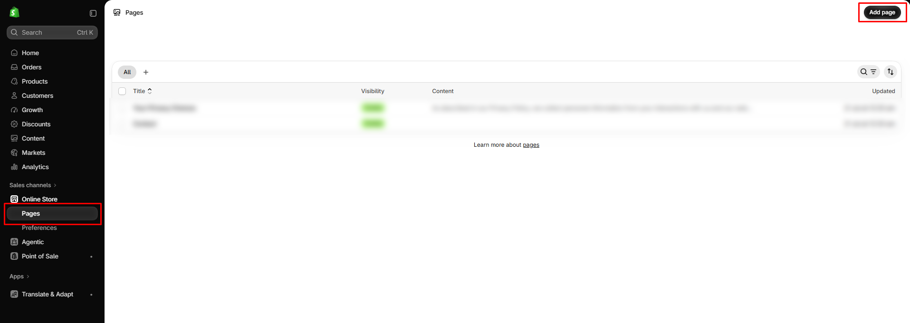

# How to create a page

Create pages such as About, Contact, or Shipping.

## How to access

1. **Go to** Shopify Admin → **Content** → **Pages**.
2. Click **Add page**.
3. Enter the **Title** and **Content**.
4. Under **Theme template**, choose **page** for a standard page or **page.contact** for a page with a contact form.
5. Click **Save**.

To show the page in your navigation, add it to a menu. See [How to create a menu](how-to-create-a-menu.md).

