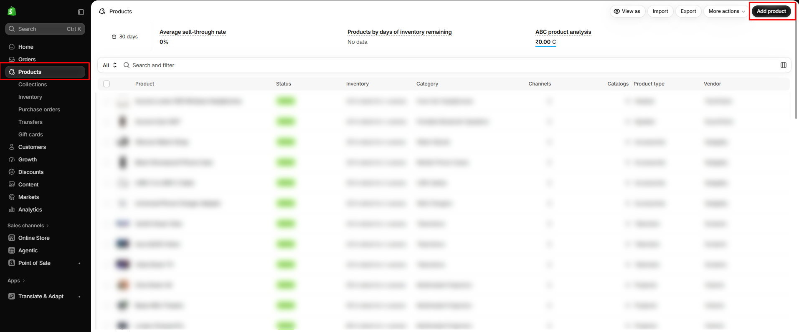

# How to create a product

Add a new product to your store.

## How to access

1. **Go to** Shopify Admin → **Products**.
2. Click **Add product**.
3. Enter the **Title** and **Description**.
4. Upload product **Media** (images or video).
5. Set the **Price** and, if needed, **Compare-at price** to show a sale price.
6. Under **Inventory**, set the SKU and quantity.
7. Under **Variants**, click **Add options like size or color** to create variants. See [How to set color to variants](how-to-set-color-to-varaints.md).
8. Set **Product category**, **Product type**, **Vendor**, and **Tags**.
9. Choose the **Collections** that should include the product.
10. Set the status to **Active** and click **Save**.


Use the same aspect ratio for product photos within a collection so the product grid stays even.


