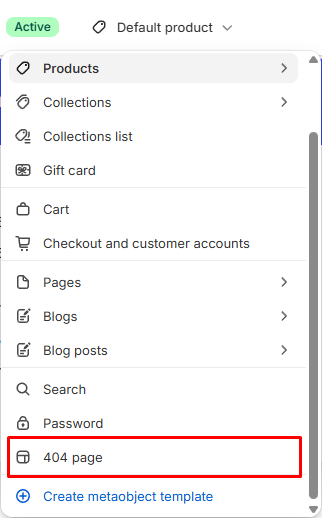

# 404

Displays the page shown when a link is broken or a page is removed.

## How to access

1. **Go to** Shopify Admin → Online Store → Themes.
2. **Click** Customize on your active theme.
3. Use the page picker at the top and open **404 page**.
4. Select **404** in the sidebar.

### Section Settings

| Setting | Description |
| ------- | ----------- |
| Direction | Sets the direction. Choose from Vertical. |
| Layout |  |
| Width | Sets the width for layout. Choose from Page or Full. |
| Height | Sets the height for layout. Choose from Auto, Small, Medium, Large, or Full screen. |
| Alignment | Sets the alignment for layout. Choose from Left, Center, or Right. |
| Position | Sets the position for layout. Choose from Top, Center, or Bottom. |
| Gap | Sets the gap for layout. Range: 0–100 px. |
| Background color | Sets the background color. |
| Padding |  |
| Top | Sets the top padding. Range: 0–100 px. |
| Bottom | Sets the bottom padding. Range: 0–100 px. |

### Blocks

Add blocks to this section in the theme editor. Each block is a separate item you can add, remove, and reorder.

This section accepts **theme blocks** (text, button, image, group, and more). See [Theme blocks](../blocks/theme-blocks.md) for every block and its settings.

App blocks from installed apps can also be added to this section.

#### Divider

Adds a divider line.

| Setting | Description |
| ------- | ----------- |
| Thickness | Sets the thickness. Range: 0.5–5 px. |
| Corner radius | Sets the corner radius. Choose from Square or Rounded. |
| Color | Sets the color. |
| Length | Sets the length. Range: 5–100%. |
| Padding |  |
| Top | Sets the top padding. Range: 0–100 px. |
| Bottom | Sets the bottom padding. Range: 0–100 px. |
