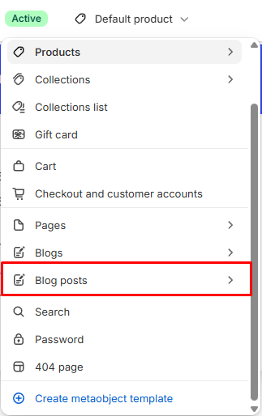

# Blog post

Displays a single blog article.

## How to access

1. **Go to** Shopify Admin → Online Store → Themes.
2. **Click** Customize on your active theme.
3. Use the page picker at the top and open **Blog posts → Default blog post**.
4. Select **Blog post** in the sidebar.

### Section Settings

| Setting | Description |
| ------- | ----------- |
| Direction | Sets the direction. Choose from Vertical. |
| Gap | Sets the gap. Range: 0–100 px. |
| Background color | Sets the background color. |
| Padding |  |
| Top | Sets the top padding. Range: 0–100 px. |
| Bottom | Sets the bottom padding. Range: 0–100 px. |

### Blocks

Add blocks to this section in the theme editor. Each block is a separate item you can add, remove, and reorder.

This section accepts **theme blocks** (text, button, image, group, and more). See [Theme blocks](../blocks/theme-blocks.md) for every block and its settings.

App blocks from installed apps can also be added to this section.

#### Title

Displays the blog post title.

| Setting | Description |
| ------- | ----------- |
| Text | Sets the text. Supports basic formatting. |
| Layout |  |
| Width | Sets the width for layout. Choose from Fit or Fill. |
| Max width | Sets the max width. Choose from Narrow, Normal, or None. |
| Alignment | Sets the alignment for layout. Choose from Left, Center, or Right. |
| Typography |  |
| Preset | Sets the preset for typography. Choose from Default, Paragraph, Heading 1, Heading 2, Heading 3, Heading 4, Heading 5, Heading 6, or Custom. Edit presets in theme settings. |
| Font | Sets the font for typography. Choose from Body, Subheading, Heading, or Accent. |
| Size | Sets the size for typography. Choose from Default, 10px, 12px, 14px, 16px, 18px, 20px, 24px, 32px, or 40px. |
| Line height | Sets the line height for typography. Choose from Tight, Normal, or Loose. |
| Letter spacing | Sets the letter spacing for typography. Choose from Tight, Normal, or Loose. |
| Case | Sets the case for typography. Choose from Default or Uppercase. |
| Wrap | Sets the wrap. Choose from Pretty, Balance, or None. |
| Appearance |  |
| Text color | Sets the text color. |
| Background | Enables or disables background. |
| Background color | Sets the background color. |
| Corner radius | Sets the corner radius for appearance. Range: 0–50. |
| Padding |  |
| Top | Sets the top padding. Range: 0–100 px. |
| Bottom | Sets the bottom padding. Range: 0–100 px. |
| Left | Sets the left padding. Range: 0–100 px. |
| Right | Sets the right padding. Range: 0–100 px. |

#### Details

Displays the blog post date, author, or other info text.

| Setting | Description |
| ------- | ----------- |
| Date | Enables or disables date. |
| Author | Enables or disables author. |
| Typography |  |
| Preset | Sets the preset for typography. Choose from Default, Paragraph, Heading 1, Heading 2, Heading 3, Heading 4, Heading 5, or Heading 6. Edit presets in theme settings. |
| Alignment | Sets the alignment for typography. Choose from Left, Center, or Right. |
| Appearance |  |
| Text color | Sets the text color. |
| Show alignment | Turn on to show alignment. |
| Padding |  |
| Top | Sets the top padding. Range: 0–100 px. |
| Bottom | Sets the bottom padding. Range: 0–100 px. |
| Left | Sets the left padding. Range: 0–100 px. |
| Right | Sets the right padding. Range: 0–100 px. |

#### Featured image

Displays the blog post featured image.

| Setting | Description |
| ------- | ----------- |
| Size |  |
| Aspect ratio | Sets the aspect ratio. Choose from Auto, Portrait, Square, or Landscape. |
| Desktop width | Sets the desktop width. Choose from Fit, Fill, or Custom. |
| Custom width | Sets the custom width. Range: 0–100%. |
| Mobile width | Sets the mobile width. Choose from Fit, Fill, or Custom. |
| Height | Sets the height for size. Choose from Fit or Fill. |
| Borders |  |
| Style | Sets the style for borders. Choose from None or Solid. |
| Thickness | Sets the thickness for borders. Range: 0–100 px. |
| Opacity | Sets the opacity for borders. Range: 0–100%. |
| Color | Sets the color. |
| Corner radius | Sets the corner radius for borders. Range: 0–100 px. |
| Padding |  |
| Top | Sets the top padding. Range: 0–100 px. |
| Bottom | Sets the bottom padding. Range: 0–100 px. |
| Left | Sets the left padding. Range: 0–100 px. |
| Right | Sets the right padding. Range: 0–100 px. |

#### Content

Displays the blog post body content.

| Setting | Description |
| ------- | ----------- |
| Text color | Sets the text color. |
