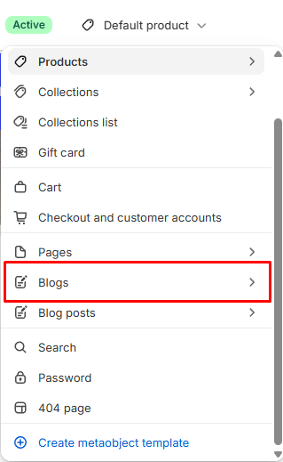

# Blog

Displays the list of articles in a blog.

## How to access

1. **Go to** Shopify Admin → Online Store → Themes.
2. **Click** Customize on your active theme.
3. Use the page picker at the top and open **Blogs → Default blog**.
4. Select **Blog** in the sidebar.

### Section Settings

| Setting | Description |
| ------- | ----------- |
| Background color | Sets the background color. |
| Padding |  |
| Top | Sets the top padding. Range: 0–100 px. |
| Bottom | Sets the bottom padding. Range: 0–100 px. |

### Blocks

Add blocks to this section in the theme editor. Each block is a separate item you can add, remove, and reorder.

This section accepts **theme blocks** (text, button, image, group, and more). See [Theme blocks](../blocks/theme-blocks.md) for every block and its settings.

Supported theme blocks: Text, Icon, Image, Button, Video, Group, Spacer. See [Theme blocks](../blocks/theme-blocks.md) for their settings.

App blocks from installed apps can also be added to this section.

#### Divider

Adds a divider line.

| Setting | Description |
| ------- | ----------- |
| Thickness | Sets the thickness. Range: 0.5–5 px. |
| Corner radius | Sets the corner radius. Choose from Square or Rounded. |
| Color | Sets the color. |
| Length | Sets the length. Range: 5–100%. |
| Padding |  |
| Top | Sets the top padding. Range: 0–100 px. |
| Bottom | Sets the bottom padding. Range: 0–100 px. |

#### Blog post

Controls how each blog post card looks.

| Setting | Description |
| ------- | ----------- |
| Alignment | Sets the alignment. Choose from Left, Center, or Right. |
| Background color | Sets the background color. |

#### Image

Displays the blog post image.

| Setting | Description |
| ------- | ----------- |
| Height | Sets the height. Choose from Small, Medium, or Large. |
| Border | Sets the border. Choose from None or Solid. |
| Border thickness | Sets the border thickness. Range: 0–10 px. |
| Border opacity | Sets the border opacity. Range: 0–100%. |
| Color | Sets the color. |
| Corner radius | Sets the corner radius. Range: 0–100 px. |

#### Details

Displays the blog post date, author, or other info text.

| Setting | Description |
| ------- | ----------- |
| Date | Enables or disables date. |
| Author | Enables or disables author. |
| Typography |  |
| Preset | Sets the preset for typography. Choose from Default, Paragraph, Heading 1, Heading 2, Heading 3, Heading 4, Heading 5, or Heading 6. Edit presets in theme settings. |
| Alignment | Sets the alignment for typography. Choose from Left, Center, or Right. |
| Appearance |  |
| Text color | Sets the text color. |
| Show alignment | Turn on to show alignment. |
| Padding |  |
| Top | Sets the top padding. Range: 0–100 px. |
| Bottom | Sets the bottom padding. Range: 0–100 px. |
| Left | Sets the left padding. Range: 0–100 px. |
| Right | Sets the right padding. Range: 0–100 px. |

#### Heading

Adds a heading.

| Setting | Description |
| ------- | ----------- |
| Preset | Sets the preset. Choose from Default, Paragraph, Heading 1, Heading 2, Heading 3, Heading 4, Heading 5, Heading 6, or Custom. Edit presets in theme settings. |
| Font | Sets the font. Choose from Body, Subheading, Heading, or Accent. |
| Size | Sets the size. Choose from Default, 10px, 12px, 14px, 16px, 18px, 20px, 24px, 32px, or 40px. |
| Line height | Sets the line height. Choose from Tight, Normal, or Loose. |
| Letter spacing | Sets the letter spacing. Choose from Tight, Normal, or Loose. |
| Case | Sets the case. Choose from Default or Uppercase. |
| Wrap | Sets the wrap. Choose from Pretty, Balance, or None. |
| Text | Sets the text. Supports basic formatting. |
| Read only | Enables or disables read only. |
| Alignment | Sets the alignment. Choose from Left, Center, or Right. |
| Show alignment | Turn on to show alignment. |
| Text color | Sets the text color. |
| Padding |  |
| Top | Sets the top padding. Range: 0–100 px. |
| Bottom | Sets the bottom padding. Range: 0–100 px. |
| Left | Sets the left padding. Range: 0–100 px. |
| Right | Sets the right padding. Range: 0–100 px. |
