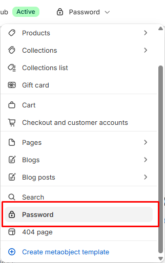

# Password

Displays the page shown while the storefront is password protected.

## How to access

1. **Go to** Shopify Admin → Online Store → Themes.
2. **Click** Customize on your active theme.
3. Use the page picker at the top and open **Password**.
4. Select **Password** in the sidebar.

### Section Settings

| Setting | Description |
| ------- | ----------- |
| Layout |  |
| Direction | Sets the direction for layout. Choose from Vertical or Horizontal. |
| Vertical on mobile | Enables or disables vertical on mobile. |
| Alignment | Sets the alignment for layout. Choose from Left, Center, Right, or Space between. |
| Position | Sets the position for layout. Choose from Top, Center, or Bottom. |
| Align text baseline | Turn on to align text baseline. |
| Alignment | Sets the alignment for layout. Choose from Left, Center, or Right. |
| Position | Sets the position for layout. Choose from Top, Center, Bottom, or Space between. |
| Gap | Sets the gap for layout. Range: 0–100 px. |
| Size |  |
| Width | Sets the width for size. Choose from Page or Full. |
| Appearance |  |
| Background media | Sets the background media. Choose from None, Image, or Video. |
| Background color | Sets the background color. |
| Video | Selects the uploaded video. |
| Video position | Sets the video position. Choose from Cover or Contain. |
| Image | Selects the image. |
| Image position | Sets the image position. Choose from Cover or Fit. |
| Padding |  |
| Top | Sets the top padding. Range: 0–100 px. |
| Bottom | Sets the bottom padding. Range: 0–100 px. |

### Blocks

Add blocks to this section in the theme editor. Each block is a separate item you can add, remove, and reorder.

This section accepts **theme blocks** (text, button, image, group, and more). See [Theme blocks](../blocks/theme-blocks.md) for every block and its settings.

App blocks from installed apps can also be added to this section.

#### Divider

Adds a divider line.

| Setting | Description |
| ------- | ----------- |
| Thickness | Sets the thickness. Range: 0.5–5 px. |
| Corner radius | Sets the corner radius. Choose from Square or Rounded. |
| Color | Sets the color. |
| Length | Sets the length. Range: 5–100%. |
| Padding |  |
| Top | Sets the top padding. Range: 0–100 px. |
| Bottom | Sets the bottom padding. Range: 0–100 px. |
