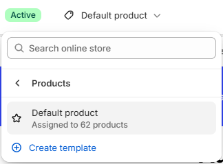

# Product information

Displays the product page: media gallery, details, variant picker, and buy buttons.

## How to access

1. **Go to** Shopify Admin → Online Store → Themes.
2. **Click** Customize on your active theme.
3. Use the page picker at the top and open **Products → Default product**.
4. Select **Product information** in the sidebar.

### Section Settings

| Setting | Description |
| ------- | ----------- |
| Layout |  |
| Width | Sets the width for layout. Choose from Page or Full. |
| Media position | Sets the media position. Choose from Left or Right. |
| Equal columns | Enables or disables equal columns. |
| Limit product details width | Turn on to limit product details width. |
| Gap | Sets the gap for layout. Range: 0–48 px. |
| Sticky add to cart bar | Turn on to sticky add to cart bar. |
| Background color | Sets the background color. |
| Padding |  |
| Top | Sets the top padding. Range: 0–100 px. |
| Bottom | Sets the bottom padding. Range: 0–100 px. |

### Blocks

Add blocks to this section in the theme editor. Each block is a separate item you can add, remove, and reorder.

This section accepts **theme blocks** (text, button, image, group, and more). See [Theme blocks](../blocks/theme-blocks.md) for every block and its settings.

App blocks from installed apps can also be added to this section.

#### Details

Holds the product details (title, price, variant picker, buy buttons).

| Setting | Description |
| ------- | ----------- |
| Size |  |
| Width | Sets the width for size. Choose from Fit, Fill, or Custom. |
| Custom width | Sets the custom width. Range: 0–100%. |
| Mobile width | Sets the mobile width. Choose from Fit, Fill, or Custom. |
| Height | Sets the height for size. Choose from Fit or Fill. |
| Layout |  |
| Position | Sets the position for layout. Choose from Top, Center, or Bottom. |
| Gap | Sets the gap for layout. Range: 0–100 px. |
| Sticky on desktop | Turn on to sticky on desktop. |
| Appearance |  |
| Background media | Sets the background media. Choose from None, Image, or Video. |
| Background color | Sets the background color. |
| Video | Selects the uploaded video. |
| Video position | Sets the video position. Choose from Cover or Contain. |
| Image | Selects the image. |
| Image position | Sets the image position. Choose from Cover or Fit. |
| Borders |  |
| Style | Sets the style for borders. Choose from None or Solid. |
| Thickness | Sets the thickness for borders. Range: 0–100 px. |
| Opacity | Sets the opacity for borders. Range: 0–100%. |
| Color | Sets the color. |
| Corner radius | Sets the corner radius for borders. Range: 0–100 px. |
| Padding |  |
| Top | Sets the top padding. Range: 0–100 px. |
| Bottom | Sets the bottom padding. Range: 0–100 px. |
| Left | Sets the left padding. Range: 0–100 px. |
| Right | Sets the right padding. Range: 0–100 px. |

#### Product media

Displays the product media gallery.

| Setting | Description |
| ------- | ----------- |
| Type | Sets the type. Choose from Grid or Carousel. Carousel is always used on mobile. |
| Grid |  |
| Columns | Sets the columns. Choose from 1 or 2. |
| Gap | Sets the gap for grid. Range: 0–100 px. |
| Full width first image | Turn on to full width first image. |
| Carousel |  |
| Icons | Sets the icons. Choose from Arrows, Chevrons, Large arrows, or Large chevrons. |
| Desktop pagination | Sets the desktop pagination. Choose from Dots, Counter, or Thumbnails. |
| Mobile pagination | Sets the mobile pagination. Choose from Dots, Counter, Hint, or Thumbnails. |
| Thumbnails |  |
| Desktop position | Sets the desktop position. Choose from Left, Bottom, or Right. |
| Desktop width | Sets the desktop width. Range: 44–72 px. |
| Corner radius | Sets the corner radius for thumbnails. Range: 0–50 px. |
| Media |  |
| Aspect ratio | Sets the aspect ratio. Choose from Auto, Portrait, Square, or Landscape. |
| Constrain to screen height | Enables or disables constrain to screen height. |
| Media fit | Sets the media fit. Choose from Cover or Contain. |
| Corner radius | Sets the corner radius for media. Range: 0–32 px. |
| Extend media to screen edge | Turn on to extend media to screen edge. |
| Enable zoom | Turn on to enable zoom. |
| Video looping | Enables or disables video looping. |
| Hide unselected variant media | Turn on to hide unselected variant media. |
| Padding |  |
| Top | Sets the top padding. Range: 0–100 px. |
| Bottom | Sets the bottom padding. Range: 0–100 px. |
| Left | Sets the left padding. Range: 0–100 px. |
| Right | Sets the right padding. Range: 0–100 px. |
