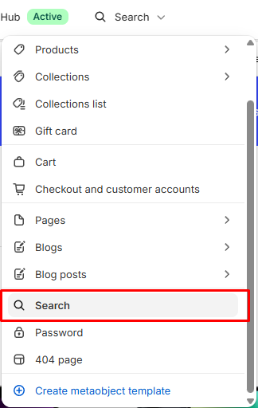

# Search header

Displays the search page heading and input.

## How to access

1. **Go to** Shopify Admin → Online Store → Themes.
2. **Click** Customize on your active theme.
3. Use the page picker at the top and open **Search**.
4. Select **Search header** in the sidebar.

### Section Settings

| Setting | Description |
| ------- | ----------- |
| Alignment | Sets the alignment. Choose from Left, Center, or Right. |
| Background color | Sets the background color. |
| Padding |  |
| Top | Sets the top padding. Range: 0–100 px. |
| Bottom | Sets the bottom padding. Range: 0–100 px. |

### Blocks

Add blocks to this section in the theme editor. Each block is a separate item you can add, remove, and reorder.

#### Heading

Adds a heading.

| Setting | Description |
| ------- | ----------- |
| Preset | Sets the preset. Choose from Default, Paragraph, Heading 1, Heading 2, Heading 3, Heading 4, Heading 5, Heading 6, or Custom. Edit presets in theme settings. |
| Font | Sets the font. Choose from Body, Subheading, Heading, or Accent. |
| Size | Sets the size. Choose from Default, 10px, 12px, 14px, 16px, 18px, 20px, 24px, 32px, or 40px. |
| Line height | Sets the line height. Choose from Tight, Normal, or Loose. |
| Letter spacing | Sets the letter spacing. Choose from Tight, Normal, or Loose. |
| Case | Sets the case. Choose from Default or Uppercase. |
| Wrap | Sets the wrap. Choose from Pretty, Balance, or None. |
| Text | Sets the text. Supports basic formatting. |
| Read only | Enables or disables read only. |
| Alignment | Sets the alignment. Choose from Left, Center, or Right. |
| Show alignment | Turn on to show alignment. |
| Text color | Sets the text color. |
| Padding |  |
| Top | Sets the top padding. Range: 0–100 px. |
| Bottom | Sets the bottom padding. Range: 0–100 px. |
| Left | Sets the left padding. Range: 0–100 px. |
| Right | Sets the right padding. Range: 0–100 px. |

#### Search input

Displays the search input field.

| Setting | Description |
| ------- | ----------- |
| Width | Sets the width. Choose from Fill or Custom. |
| Custom width | Sets the custom width. Range: 0–100%. |
| Input |  |
| Style | Sets the style for input. Choose from Default or Custom. Edit input field in theme settings. |
| Background | Sets the input background color. |
| Text | Sets the input text color. |
| Borders | Sets the input borders color. |
| Border thickness | Sets the border thickness. Range: 0–4 px. |
| Corner radius | Sets the corner radius for input. Range: 0–50 px. |
