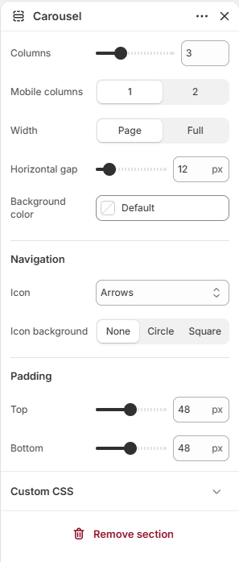

# Carousel

Displays a scrolling carousel of content blocks.

## How to access

1. **Go to** Shopify Admin → Online Store → Themes.
2. **Click** Customize on your active theme.
3. Open a page such as **Home page** from the page picker.
4. Click **Add section** and choose **Carousel**, or select an existing Carousel section.

### Section Settings

| Setting | Description |
| ------- | ----------- |
| Columns | Sets the columns. Range: 1–8. |
| Mobile columns | Sets the mobile columns. Choose from 1 or 2. |
| Width | Sets the width. Choose from Page or Full. |
| Horizontal gap | Sets the horizontal gap. Range: 0–100 px. |
| Background color | Sets the background color. |
| Navigation |  |
| Icon | Sets the icon for navigation. Choose from Arrows, Chevrons, Large arrows, Large chevrons, or None. |
| Icon background | Sets the icon background. Choose from None, Circle, or Square. |
| Padding |  |
| Top | Sets the top padding. Range: 0–100 px. |
| Bottom | Sets the bottom padding. Range: 0–100 px. |
