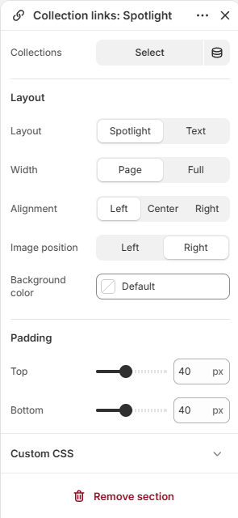
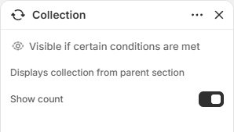
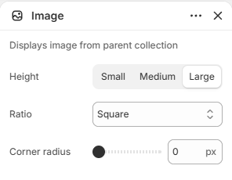
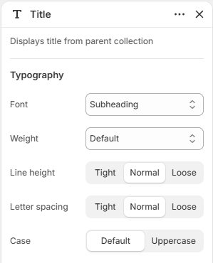

# Collection links

Displays a text-led list of collections with an optional hover image.

## How to access

1. **Go to** Shopify Admin → Online Store → Themes.
2. **Click** Customize on your active theme.
3. Open a page such as **Home page** from the page picker.
4. Click **Add section** and choose **Collection links**, or select an existing Collection links section.

### Section Settings

| Setting | Description |
| ------- | ----------- |
| Collections | Selects the collections to display. |
| Layout |  |
| Layout | Sets the layout for layout. Choose from Spotlight or Text. |
| Width | Sets the width for layout. Choose from Page or Full. |
| Alignment | Sets the alignment for layout. Choose from Left, Center, or Right. |
| Image position | Sets the image position. Choose from Left or Right. |
| Background color | Sets the background color. |
| Padding |  |
| Top | Sets the top padding. Range: 0–100 px. |
| Bottom | Sets the bottom padding. Range: 0–100 px. |

### Blocks

Add blocks to this section in the theme editor. Each block is a separate item you can add, remove, and reorder.

#### Collection

Adds a linked collection entry.

| Setting | Description |
| ------- | ----------- |
| Show count | Turn on to show count. |

#### Image

Adds a image to the section.

| Setting | Description |
| ------- | ----------- |
| Height | Sets the height. Choose from Small, Medium, or Large. |
| Ratio | Sets the ratio. Choose from Portrait, Square, or Landscape. |
| Corner radius | Sets the corner radius. Range: 0–32 px. |

#### Collection title

Adds a collection title to the section.

| Setting | Description |
| ------- | ----------- |
| Typography |  |
| Font | Sets the font for typography. Choose from Body, Subheading, Heading, or Accent. |
| Weight | Sets the weight for typography. Choose from Default, Thin, Light, Regular, Medium, Semibold, Bold, or Black. |
| Line height | Sets the line height for typography. Choose from Tight, Normal, or Loose. |
| Letter spacing | Sets the letter spacing for typography. Choose from Tight, Normal, or Loose. |
| Case | Sets the case for typography. Choose from Default or Uppercase. |
