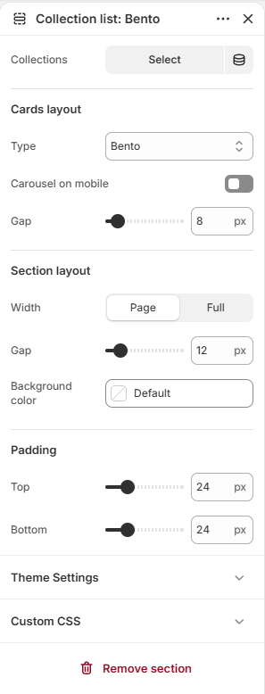
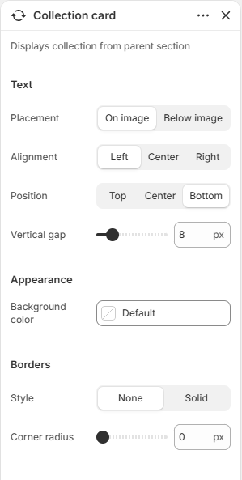
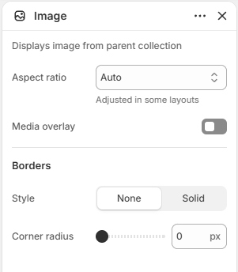

# Collection list

Displays a set of collections as cards in a grid, carousel, bento, or editorial layout.

## How to access

1. **Go to** Shopify Admin → Online Store → Themes.
2. **Click** Customize on your active theme.
3. Open a page such as **Home page** from the page picker.
4. Click **Add section** and choose **Collection list**, or select an existing Collection list section.

### Section Settings

| Setting | Description |
| ------- | ----------- |
| Collections | Selects the collections to display. |
| Cards layout |  |
| Type | Sets the type for cards layout. Choose from Grid, Carousel, Bento, or Editorial. |
| Carousel on mobile | Enables or disables carousel on mobile. |
| Columns | Sets the columns. Range: 1–8. |
| Mobile columns | Sets the mobile columns. Choose from 1 or 2. |
| Horizontal gap | Sets the horizontal gap. Range: 0–100 px. |
| Gap | Sets the gap for cards layout. Range: 0–100 px. |
| Vertical gap | Sets the vertical gap. Range: 0–100 px. |
| Collection count | Sets the collection count. Range: 1–16. |
| Carousel navigation |  |
| Icon | Sets the icon for carousel navigation. Choose from Arrows, Chevrons, Large arrows, Large chevrons, or None. |
| Icon background | Sets the icon background. Choose from None, Circle, or Square. |
| Section layout |  |
| Width | Sets the width for section layout. Choose from Page or Full. |
| Gap | Sets the gap for section layout. Range: 0–100 px. |
| Background color | Sets the background color. |
| Padding |  |
| Top | Sets the top padding. Range: 0–100 px. |
| Bottom | Sets the bottom padding. Range: 0–100 px. |

### Blocks

Add blocks to this section in the theme editor. Each block is a separate item you can add, remove, and reorder.

This section accepts **theme blocks** (text, button, image, group, and more). See [Theme blocks](../blocks/theme-blocks.md) for every block and its settings.

Supported theme blocks: Text, Icon, Image, Button, Video, Group, Spacer. See [Theme blocks](../blocks/theme-blocks.md) for their settings.

App blocks from installed apps can also be added to this section.

#### Divider

Adds a divider line.

| Setting | Description |
| ------- | ----------- |
| Thickness | Sets the thickness. Range: 0.5–5 px. |
| Corner radius | Sets the corner radius. Choose from Square or Rounded. |
| Color | Sets the color. |
| Length | Sets the length. Range: 5–100%. |
| Padding |  |
| Top | Sets the top padding. Range: 0–100 px. |
| Bottom | Sets the bottom padding. Range: 0–100 px. |

#### Collection card

Displays a collection card.

| Setting | Description |
| ------- | ----------- |
| Text |  |
| Placement | Sets the placement. Choose from On image or Below image. |
| Alignment | Sets the alignment for text. Choose from Left, Center, or Right. |
| Position | Sets the position for text. Choose from Top, Center, or Bottom. |
| Vertical gap | Sets the vertical gap. Range: 0–50 px. |
| Appearance |  |
| Background color | Sets the background color. |
| Borders |  |
| Style | Sets the style for borders. Choose from None or Solid. |
| Thickness | Sets the thickness for borders. Range: 0–100 px. |
| Opacity | Sets the opacity for borders. Range: 0–100%. |
| Color | Sets the color. |
| Corner radius | Sets the corner radius for borders. Range: 0–100 px. |

#### Image

Adds a image to the section.

| Setting | Description |
| ------- | ----------- |
| Aspect ratio | Sets the aspect ratio. Choose from Auto, Portrait, Square, or Landscape. Adjusted in some layouts. |
| Media overlay | Enables or disables media overlay. |
| Overlay color | Sets the overlay color. |
| Overlay style | Sets the overlay style. Choose from Solid or Gradient. |
| Gradient direction | Sets the gradient direction. Choose from Up or Down. |
| Borders |  |
| Style | Sets the style for borders. Choose from None or Solid. |
| Thickness | Sets the thickness for borders. Range: 0–100 px. |
| Opacity | Sets the opacity for borders. Range: 0–100%. |
| Color | Sets the color. |
| Corner radius | Sets the corner radius for borders. Range: 0–100 px. |
