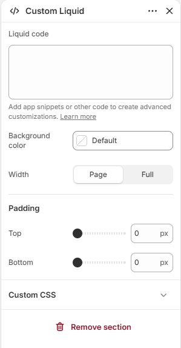

# Custom liquid

Adds your own Liquid, HTML, or CSS to the page.

## How to access

1. **Go to** Shopify Admin → Online Store → Themes.
2. **Click** Customize on your active theme.
3. Open a page such as **Home page** from the page picker.
4. Click **Add section** and choose **Custom liquid**, or select an existing Custom liquid section.

### Section Settings

| Setting | Description |
| ------- | ----------- |
| Liquid code | Adds custom Liquid, HTML, or CSS code (liquid code). Add app snippets or other code to create advanced customizations. Learn more. |
| Background color | Sets the background color. |
| Width | Sets the width. Choose from Page or Full. |
| Padding |  |
| Top | Sets the top padding. Range: 0–100 px. |
| Bottom | Sets the bottom padding. Range: 0–100 px. |
