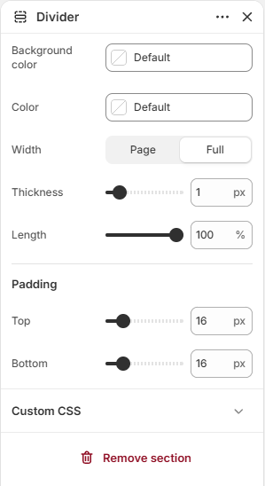

# Divider

Displays a horizontal divider line between sections.

## How to access

1. **Go to** Shopify Admin → Online Store → Themes.
2. **Click** Customize on your active theme.
3. Open a page such as **Home page** from the page picker.
4. Click **Add section** and choose **Divider**, or select an existing Divider section.

### Section Settings

| Setting | Description |
| ------- | ----------- |
| Background color | Sets the background color. |
| Color | Sets the color. |
| Width | Sets the width. Choose from Page or Full. |
| Thickness | Sets the thickness. Range: 0.5–5 px. |
| Corner radius | Sets the corner radius. Choose from Square or Rounded. |
| Length | Sets the length. Range: 5–100%. |
| Alignment | Sets the alignment. Choose from Left, Center, or Right. |
| Padding |  |
| Top | Sets the top padding. Range: 0–100 px. |
| Bottom | Sets the bottom padding. Range: 0–100 px. |
