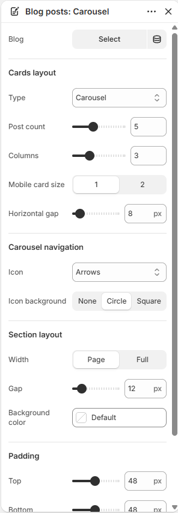
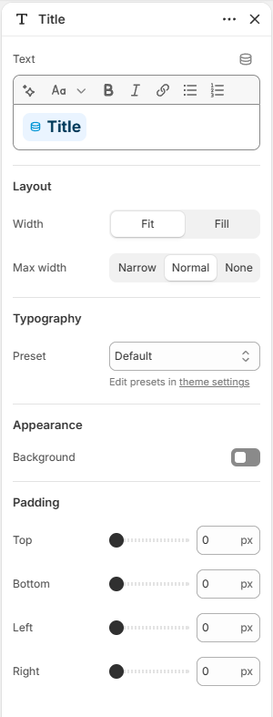
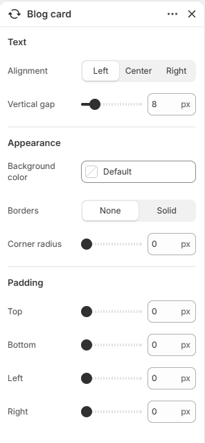
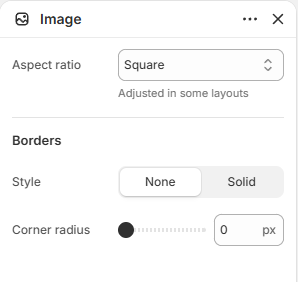

# Blog posts

Displays recent articles from a blog.

## How to access

1. **Go to** Shopify Admin → Online Store → Themes.
2. **Click** Customize on your active theme.
3. Open a page such as **Home page** from the page picker.
4. Click **Add section** and choose **Blog posts**, or select an existing Blog posts section.

### Section Settings

| Setting | Description |
| ------- | ----------- |
| Blog | Selects the blog to display. |
| Cards layout |  |
| Type | Sets the type for cards layout. Choose from Grid, Carousel, or Editorial. |
| Carousel on mobile | Enables or disables carousel on mobile. |
| Post count | Sets the post count. Range: 2–10. |
| Columns | Sets the columns. Range: 1–8. |
| Mobile columns | Sets the mobile columns. Choose from 1 or 2. |
| Mobile card size | Sets the mobile card size. Choose from 1 or 2. |
| Horizontal gap | Sets the horizontal gap. Range: 0–100 px. |
| Vertical gap | Sets the vertical gap. Range: 0–100 px. |
| Carousel navigation |  |
| Icon | Sets the icon for carousel navigation. Choose from Arrows, Chevrons, Large arrows, Large chevrons, or None. |
| Icon background | Sets the icon background. Choose from None, Circle, or Square. |
| Section layout |  |
| Width | Sets the width for section layout. Choose from Page or Full. |
| Gap | Sets the gap for section layout. Range: 0–100 px. |
| Background color | Sets the background color. |
| Padding |  |
| Top | Sets the top padding. Range: 0–100 px. |
| Bottom | Sets the bottom padding. Range: 0–100 px. |

### Blocks

Add blocks to this section in the theme editor. Each block is a separate item you can add, remove, and reorder.

#### Title

Adds the section heading for the blog posts.

| Setting | Description |
| ------- | ----------- |
| Text | Sets the text. Supports basic formatting. |
| Layout |  |
| Width | Sets the width for layout. Choose from Fit or Fill. |
| Max width | Sets the max width. Choose from Narrow, Normal, or None. |
| Alignment | Sets the alignment for layout. Choose from Left, Center, or Right. |
| Typography |  |
| Preset | Sets the preset for typography. Choose from Default, Paragraph, Heading 1, Heading 2, Heading 3, Heading 4, Heading 5, Heading 6, or Custom. Edit presets in theme settings. |
| Font | Sets the font for typography. Choose from Body, Subheading, Heading, or Accent. |
| Size | Sets the size for typography. Choose from Default, 10px, 12px, 14px, 16px, 18px, 20px, 24px, 32px, or 40px. |
| Line height | Sets the line height for typography. Choose from Tight, Normal, or Loose. |
| Letter spacing | Sets the letter spacing for typography. Choose from Tight, Normal, or Loose. |
| Case | Sets the case for typography. Choose from Default or Uppercase. |
| Wrap | Sets the wrap. Choose from Pretty, Balance, or None. |
| Appearance |  |
| Background | Enables or disables background. |
| Background color | Sets the background color. |
| Corner radius | Sets the corner radius for appearance. Range: 0–50. |
| Padding |  |
| Top | Sets the top padding. Range: 0–100 px. |
| Bottom | Sets the bottom padding. Range: 0–100 px. |
| Left | Sets the left padding. Range: 0–100 px. |
| Right | Sets the right padding. Range: 0–100 px. |

#### Blog card

Controls how each blog post card looks.

| Setting | Description |
| ------- | ----------- |
| Text |  |
| Alignment | Sets the alignment for text. Choose from Left, Center, or Right. |
| Vertical gap | Sets the vertical gap. Range: 0–50 px. |
| Appearance |  |
| Background color | Sets the background color. |
| Borders | Sets the borders. Choose from None or Solid. |
| Border thickness | Sets the border thickness. Range: 0–10 px. |
| Opacity | Sets the opacity for appearance. Range: 0–100%. |
| Color | Sets the color. |
| Corner radius | Sets the corner radius for appearance. Range: 0–100 px. |
| Padding |  |
| Top | Sets the top padding. Range: 0–100 px. |
| Bottom | Sets the bottom padding. Range: 0–100 px. |
| Left | Sets the left padding. Range: 0–100 px. |
| Right | Sets the right padding. Range: 0–100 px. |

#### Image

Displays the blog post image.

| Setting | Description |
| ------- | ----------- |
| Aspect ratio | Sets the aspect ratio. Choose from Auto, Portrait, Square, or Landscape. Adjusted in some layouts. |
| Borders |  |
| Style | Sets the style for borders. Choose from None or Solid. |
| Thickness | Sets the thickness for borders. Range: 0–100 px. |
| Opacity | Sets the opacity for borders. Range: 0–100%. |
| Color | Sets the color. |
| Corner radius | Sets the corner radius for borders. Range: 0–100 px. |

#### Description

Displays the blog post excerpt.

| Setting | Description |
| ------- | ----------- |
| Typography |  |
| Preset | Sets the preset for typography. Choose from Default, Paragraph, Heading 1, Heading 2, Heading 3, Heading 4, Heading 5, Heading 6, or Custom. Edit presets in theme settings. |
| Font | Sets the font for typography. Choose from Body, Subheading, Heading, or Accent. |
| Size | Sets the size for typography. Choose from Default, 10px, 12px, 14px, 16px, 18px, 20px, 24px, 32px, or 40px. |
| Line height | Sets the line height for typography. Choose from Tight, Normal, or Loose. |
| Letter spacing | Sets the letter spacing for typography. Choose from Tight, Normal, or Loose. |
| Case | Sets the case for typography. Choose from Default or Uppercase. |
| Wrap | Sets the wrap. Choose from Pretty, Balance, or None. |
| Appearance |  |
| Text color | Sets the text color. |
| Padding |  |
| Top | Sets the top padding. Range: 0–100 px. |
| Bottom | Sets the bottom padding. Range: 0–100 px. |
| Left | Sets the left padding. Range: 0–100 px. |
| Right | Sets the right padding. Range: 0–100 px. |

#### Details

Displays the blog post date, author, or other info text.

| Setting | Description |
| ------- | ----------- |
| Date | Enables or disables date. |
| Author | Enables or disables author. |
| Typography |  |
| Preset | Sets the preset for typography. Choose from Default, Paragraph, Heading 1, Heading 2, Heading 3, Heading 4, Heading 5, or Heading 6. Edit presets in theme settings. |
| Alignment | Sets the alignment for typography. Choose from Left, Center, or Right. |
| Appearance |  |
| Text color | Sets the text color. |
| Show alignment | Turn on to show alignment. |
| Padding |  |
| Top | Sets the top padding. Range: 0–100 px. |
| Bottom | Sets the bottom padding. Range: 0–100 px. |
| Left | Sets the left padding. Range: 0–100 px. |
| Right | Sets the right padding. Range: 0–100 px. |

#### Heading

Adds a heading.

| Setting | Description |
| ------- | ----------- |
| Preset | Sets the preset. Choose from Default, Paragraph, Heading 1, Heading 2, Heading 3, Heading 4, Heading 5, Heading 6, or Custom. Edit presets in theme settings. |
| Font | Sets the font. Choose from Body, Subheading, Heading, or Accent. |
| Size | Sets the size. Choose from Default, 10px, 12px, 14px, 16px, 18px, 20px, 24px, 32px, or 40px. |
| Line height | Sets the line height. Choose from Tight, Normal, or Loose. |
| Letter spacing | Sets the letter spacing. Choose from Tight, Normal, or Loose. |
| Case | Sets the case. Choose from Default or Uppercase. |
| Wrap | Sets the wrap. Choose from Pretty, Balance, or None. |
| Text | Sets the text. Supports basic formatting. |
| Read only | Enables or disables read only. |
| Alignment | Sets the alignment. Choose from Left, Center, or Right. |
| Show alignment | Turn on to show alignment. |
| Text color | Sets the text color. |
| Padding |  |
| Top | Sets the top padding. Range: 0–100 px. |
| Bottom | Sets the bottom padding. Range: 0–100 px. |
| Left | Sets the left padding. Range: 0–100 px. |
| Right | Sets the right padding. Range: 0–100 px. |
