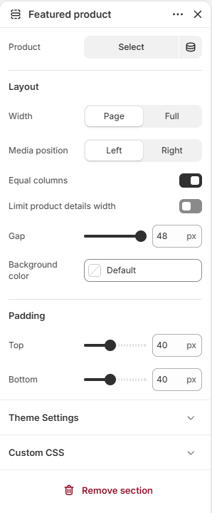

# Featured product

Displays a single product with its media and details.

## How to access

1. **Go to** Shopify Admin → Online Store → Themes.
2. **Click** Customize on your active theme.
3. Open a page such as **Home page** from the page picker.
4. Click **Add section** and choose **Featured product**, or select an existing Featured product section.

### Section Settings

| Setting | Description |
| ------- | ----------- |
| Product | Selects the product to display. |
| Media position | Sets the media position. Choose from Left or Right. |
| Background color | Sets the background color. |
| Padding |  |
| Top | Sets the top padding. Range: 0–100 px. |
| Bottom | Sets the bottom padding. Range: 0–100 px. |
