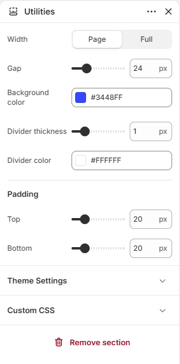

# Footer utilities

Displays the bottom bar of the footer with copyright, policy links, and social icons.

## How to access

1. **Go to** Shopify Admin → Online Store → Themes.
2. **Click** Customize on your active theme.
3. Open the **Footer** group at the bottom of the sidebar and select **Footer utilities**.

### Section Settings

| Setting | Description |
| ------- | ----------- |
| Width | Sets the width. Choose from Page or Full. |
| Gap | Sets the gap. Range: 0–100 px. |
| Background color | Sets the background color. |
| Divider thickness | Sets the divider thickness. Range: 0–5 px. |
| Divider color | Sets the divider color. |
| Padding |  |
| Top | Sets the top padding. Range: 0–100 px. |
| Bottom | Sets the bottom padding. Range: 0–100 px. |

### Blocks

Add blocks to this section in the theme editor. Each block is a separate item you can add, remove, and reorder.

Supported theme blocks: Copyright, Policy links, Social media links. See [Theme blocks](../blocks/theme-blocks.md) for their settings.
