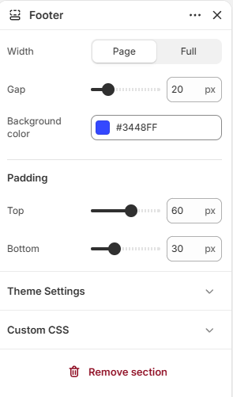
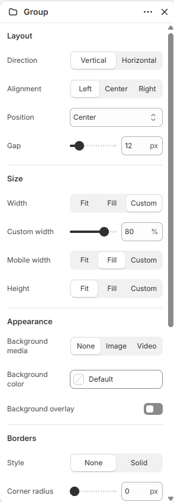

# Footer

Displays the store footer built from groups of blocks such as menus, text, and images.

## How to access

1. **Go to** Shopify Admin → Online Store → Themes.
2. **Click** Customize on your active theme.
3. Open the **Footer** group at the bottom of the sidebar and select **Footer**.

### Section Settings

| Setting | Description |
| ------- | ----------- |
| Width | Sets the width. Choose from Page or Full. |
| Gap | Sets the gap. Range: 0–100 px. |
| Background color | Sets the background color. |
| Padding |  |
| Top | Sets the top padding. Range: 0–100 px. |
| Bottom | Sets the bottom padding. Range: 0–100 px. |

### Blocks

Add blocks to this section in the theme editor. Each block is a separate item you can add, remove, and reorder.

Supported theme blocks: Button, Follow on Shop, Group, Icon, Image, Menu, Payment icons, Text, Logo, Jumbo text, Social media links, Email signup. See [Theme blocks](../blocks/theme-blocks.md) for their settings.

App blocks from installed apps can also be added to this section.

#### Divider

Adds a divider line.

| Setting | Description |
| ------- | ----------- |
| Thickness | Sets the thickness. Range: 0.5–5 px. |
| Corner radius | Sets the corner radius. Choose from Square or Rounded. |
| Color | Sets the color. |
| Length | Sets the length. Range: 5–100%. |
| Padding |  |
| Top | Sets the top padding. Range: 0–100 px. |
| Bottom | Sets the bottom padding. Range: 0–100 px. |
