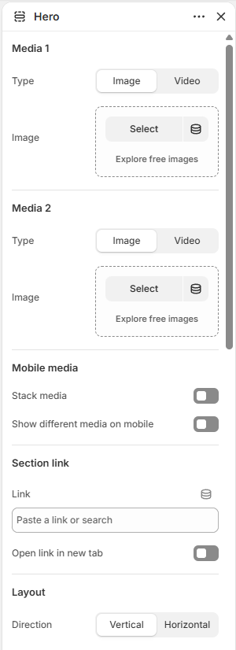
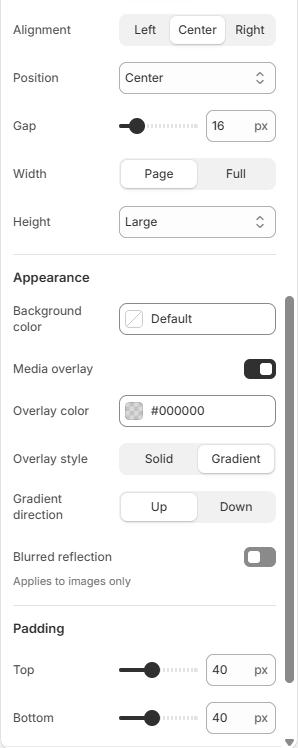
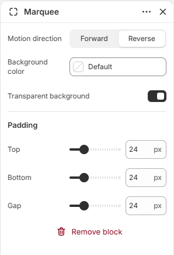

# Hero

Displays a large banner with one or two media items and layered content.

## How to access

1. **Go to** Shopify Admin → Online Store → Themes.
2. **Click** Customize on your active theme.
3. Open a page such as **Home page** from the page picker.
4. Click **Add section** and choose **Hero**, or select an existing Hero section.

### Section Settings

| Setting | Description |
| ------- | ----------- |
| Media 1 |  |
| Type | Sets the type for media 1. Choose from Image or Video. |
| Image | Selects the image. |
| Video | Selects the uploaded video. |
| Media 2 |  |
| Type | Sets the type for media 2. Choose from Image or Video. |
| Mobile media |  |
| Stack media | Turn on to stack media. |
| Show different media on mobile | Turn on to show different media on mobile. |
| Mobile media 1 |  |
| Type | Sets the type for mobile media 1. Choose from Image or Video. |
| Image | Selects the image. |
| Video | Selects the uploaded video. |
| Mobile media 2 |  |
| Type | Sets the type for mobile media 2. Choose from Image or Video. |
| Section link |  |
| Link | Sets the link destination. |
| Open link in new tab | Turn on to open link in new tab. |
| Layout |  |
| Direction | Sets the direction for layout. Choose from Vertical or Horizontal. |
| Vertical on mobile | Enables or disables vertical on mobile. |
| Alignment | Sets the alignment for layout. Choose from Left, Center, Right, or Space between. |
| Position | Sets the position for layout. Choose from Top, Center, or Bottom. |
| Align text baseline | Turn on to align text baseline. |
| Alignment | Sets the alignment for layout. Choose from Left, Center, or Right. |
| Position | Sets the position for layout. Choose from Top, Center, Bottom, or Space between. |
| Gap | Sets the gap for layout. Range: 0–100 px. |
| Width | Sets the width for layout. Choose from Page or Full. |
| Height | Sets the height for layout. Choose from Auto, Small, Medium, Large, Full screen, or Custom. |
| Custom height | Sets the custom height. Range: 0–100%. |
| Appearance |  |
| Background color | Sets the background color. |
| Media overlay | Enables or disables media overlay. |
| Overlay color | Sets the overlay color. |
| Overlay style | Sets the overlay style. Choose from Solid or Gradient. |
| Gradient direction | Sets the gradient direction. Choose from Up or Down. |
| Blurred reflection | Enables or disables blurred reflection. Applies to images only. |
| Reflection opacity | Sets the reflection opacity. Range: 0–100%. |
| Padding |  |
| Top | Sets the top padding. Range: 0–100 px. |
| Bottom | Sets the bottom padding. Range: 0–100 px. |

### Blocks

Add blocks to this section in the theme editor. Each block is a separate item you can add, remove, and reorder.

This section accepts **theme blocks** (text, button, image, group, and more). See [Theme blocks](../blocks/theme-blocks.md) for every block and its settings.

Supported theme blocks: Text, Button, Logo, Jumbo text, Spacer, Group. See [Theme blocks](../blocks/theme-blocks.md) for their settings.

#### Marquee

Adds a scrolling strip inside the section.

| Setting | Description |
| ------- | ----------- |
| Motion direction | Sets the motion direction. Choose from Forward or Reverse. |
| Background color | Sets the background color. |
| Transparent background | Enables or disables transparent background. |
| Padding |  |
| Top | Sets the top padding. Range: 0–100 px. |
| Bottom | Sets the bottom padding. Range: 0–100 px. |
| Gap | Sets the gap padding. Range: 0–100 px. |
