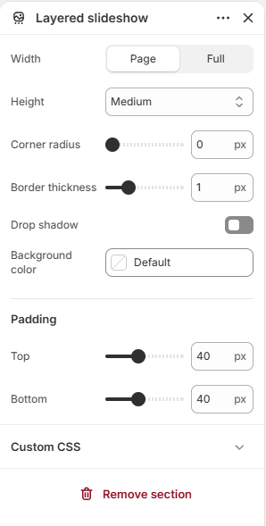
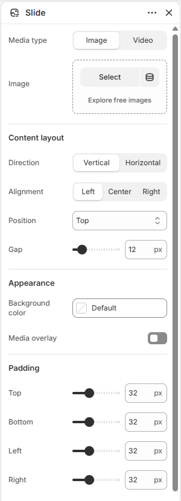

# Layered slideshow

Displays stacked, overlapping slides that expand on interaction.

## How to access

1. **Go to** Shopify Admin → Online Store → Themes.
2. **Click** Customize on your active theme.
3. Open a page such as **Home page** from the page picker.
4. Click **Add section** and choose **Layered slideshow**, or select an existing Layered slideshow section.

### Section Settings

| Setting | Description |
| ------- | ----------- |
| Width | Sets the width. Choose from Page or Full. |
| Height | Sets the height. Choose from Auto, Small, Medium, or Large. |
| Corner radius | Sets the corner radius. Range: 0–32 px. |
| Border thickness | Sets the border thickness. Range: 0–4 px. |
| Drop shadow | Enables or disables drop shadow. |
| Background color | Sets the background color. |
| Padding |  |
| Top | Sets the top padding. Range: 0–100 px. |
| Bottom | Sets the bottom padding. Range: 0–100 px. |

### Blocks

Add blocks to this section in the theme editor. Each block is a separate item you can add, remove, and reorder.

#### Slide

Adds one layered slide to the layered slideshow.

| Setting | Description |
| ------- | ----------- |
| Media type | Sets the media type. Choose from Image or Video. |
| Image | Selects the image. |
| Video | Selects the uploaded video. |
| Content layout |  |
| Direction | Sets the direction for content layout. Choose from Vertical or Horizontal. |
| Vertical on mobile | Enables or disables vertical on mobile. |
| Alignment | Sets the alignment for content layout. Choose from Left, Center, Right, or Space between. |
| Position | Sets the position for content layout. Choose from Top, Center, or Bottom. |
| Align text baseline | Turn on to align text baseline. |
| Alignment | Sets the alignment for content layout. Choose from Left, Center, or Right. |
| Position | Sets the position for content layout. Choose from Top, Center, Bottom, or Space between. |
| Gap | Sets the gap for content layout. Range: 0–100 px. |
| Appearance |  |
| Background color | Sets the background color. |
| Media overlay | Enables or disables media overlay. |
| Overlay color | Sets the overlay color. |
| Overlay style | Sets the overlay style. Choose from Solid or Gradient. |
| Gradient direction | Sets the gradient direction. Choose from Up or Down. |
| Padding |  |
| Top | Sets the top padding. Range: 0–100 px. |
| Bottom | Sets the bottom padding. Range: 0–100 px. |
| Left | Sets the left padding. Range: 0–100 px. |
| Right | Sets the right padding. Range: 0–100 px. |
