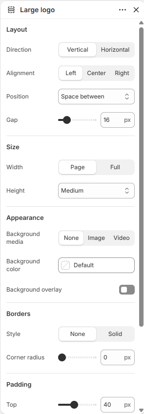

# Logo

Displays the store logo as a standalone section.

## How to access

1. **Go to** Shopify Admin → Online Store → Themes.
2. **Click** Customize on your active theme.
3. Open a page such as **Home page** from the page picker.
4. Click **Add section** and choose **Logo**, or select an existing Logo section.

### Section Settings

| Setting | Description |
| ------- | ----------- |
| Use inverse logo | Turn on to use inverse logo. |
| Font | Sets the font. Choose from Body, Subheading, Heading, or Accent. |
| Size |  |
| Unit | Sets the unit. Choose from Pixel or Percent. |
| Height | Sets the height for size. Range: 16–320 px. |
| Width | Sets the width for size. Range: 10–100%. |
| Custom mobile size | Enables or disables custom mobile size. |
| Mobile size |  |
| Width | Sets the width for mobile size. Range: 10–100%. |
| Height | Sets the height for mobile size. Range: 16–160 px. |
| Layout |  |
| Width | Sets the width for layout. Choose from Page or Full. |
| Alignment | Sets the alignment for layout. Choose from Left, Center, or Right. |
| Background color | Sets the background color. |
| Padding |  |
| Top | Sets the top padding. Range: 0–100 px. |
| Bottom | Sets the bottom padding. Range: 0–100 px. |
