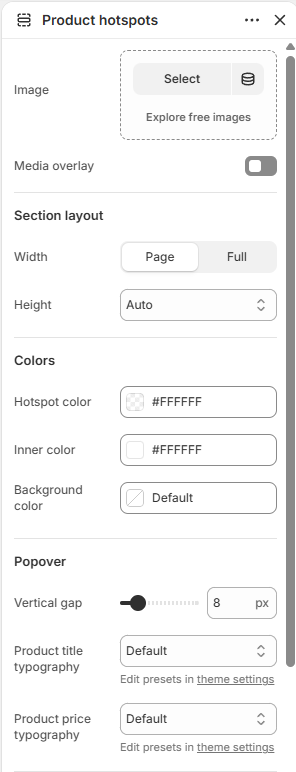

# Product hotspots

Displays an image with clickable hotspots that open product popovers.

## How to access

1. **Go to** Shopify Admin → Online Store → Themes.
2. **Click** Customize on your active theme.
3. Open a page such as **Home page** from the page picker.
4. Click **Add section** and choose **Product hotspots**, or select an existing Product hotspots section.

### Section Settings

| Setting | Description |
| ------- | ----------- |
| Image | Selects the image. |
| Media overlay | Enables or disables media overlay. |
| Overlay color | Sets the overlay color. |
| Overlay style | Sets the overlay style. Choose from Solid or Gradient. |
| Gradient direction | Sets the gradient direction. Choose from Up or Down. |
| Section layout |  |
| Width | Sets the width for section layout. Choose from Page or Full. |
| Height | Sets the height for section layout. Choose from Auto, Small, Medium, or Large. |
| Colors |  |
| Hotspot color | Sets the hotspot color. |
| Inner color | Sets the inner color. |
| Background color | Sets the background color. |
| Popover |  |
| Vertical gap | Sets the vertical gap. Range: 0–50 px. |
| Product title typography | Sets the product title typography. Choose from Default, Paragraph, Heading 4, Heading 5, or Heading 6. Edit presets in theme settings. |
| Product price typography | Sets the product price typography. Choose from Default, Paragraph, Heading 4, Heading 5, or Heading 6. Edit presets in theme settings. |
| Padding |  |
| Top | Sets the top padding. Range: 0–100 px. |
| Bottom | Sets the bottom padding. Range: 0–100 px. |

### Blocks

Add blocks to this section in the theme editor. Each block is a separate item you can add, remove, and reorder.

#### Hotspot

Adds a clickable hotspot that opens a product popover.

| Setting | Description |
| ------- | ----------- |
| Product | Selects the product to display. |
| Horizontal position | Sets the horizontal position. Range: 0–100. |
| Vertical position | Sets the vertical position. Range: 0–100. |
