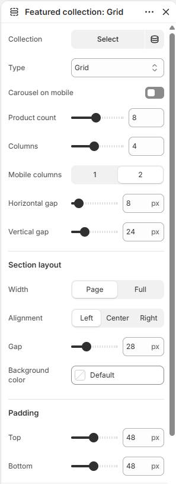
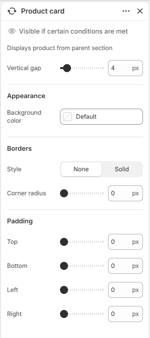

# Featured collection

Displays a heading and a grid or carousel of products from one collection.

## How to access

1. **Go to** Shopify Admin → Online Store → Themes.
2. **Click** Customize on your active theme.
3. Open a page such as **Home page** from the page picker.
4. Click **Add section** and choose **Featured collection**, or select an existing Featured collection section. This section is also used on: 404 page, Cart.

### Section Settings

| Setting | Description |
| ------- | ----------- |
| Collection | Selects the collection to display. |
| Type | Sets the type. Choose from Grid, Carousel, or Editorial. |
| Carousel on mobile | Enables or disables carousel on mobile. |
| Product count | Sets the product count. Range: 1–16. |
| Columns | Sets the columns. Range: 1–8. |
| Mobile columns | Sets the mobile columns. Choose from 1 or 2. |
| Horizontal gap | Sets the horizontal gap. Range: 0–100 px. |
| Vertical gap | Sets the vertical gap. Range: 0–100 px. |
| Carousel navigation |  |
| Icon | Sets the icon for carousel navigation. Choose from Arrows, Chevrons, Large arrows, Large chevrons, or None. |
| Icon background | Sets the icon background. Choose from None, Circle, or Square. |
| Section layout |  |
| Width | Sets the width for section layout. Choose from Page or Full. |
| Alignment | Sets the alignment for section layout. Choose from Left, Center, or Right. |
| Gap | Sets the gap for section layout. Range: 0–100 px. |
| Background color | Sets the background color. |
| Padding |  |
| Top | Sets the top padding. Range: 0–100 px. |
| Bottom | Sets the bottom padding. Range: 0–100 px. |

### Blocks

Add blocks to this section in the theme editor. Each block is a separate item you can add, remove, and reorder.

This section accepts **theme blocks** (text, button, image, group, and more). See [Theme blocks](../blocks/theme-blocks.md) for every block and its settings.

App blocks from installed apps can also be added to this section.

#### Divider

Adds a divider line.

| Setting | Description |
| ------- | ----------- |
| Thickness | Sets the thickness. Range: 0.5–5 px. |
| Corner radius | Sets the corner radius. Choose from Square or Rounded. |
| Color | Sets the color. |
| Length | Sets the length. Range: 5–100%. |
| Padding |  |
| Top | Sets the top padding. Range: 0–100 px. |
| Bottom | Sets the bottom padding. Range: 0–100 px. |

#### Product card

Controls how each product card looks inside the section.

| Setting | Description |
| ------- | ----------- |
| Vertical gap | Sets the vertical gap. Range: 0–50 px. |
| Appearance |  |
| Background color | Sets the background color. |
| Borders |  |
| Style | Sets the style for borders. Choose from None or Solid. |
| Thickness | Sets the thickness for borders. Range: 0–100 px. |
| Opacity | Sets the opacity for borders. Range: 0–100%. |
| Color | Sets the color. |
| Corner radius | Sets the corner radius for borders. Range: 0–32 px. |
| Padding |  |
| Top | Sets the top padding. Range: 0–50 px. |
| Bottom | Sets the bottom padding. Range: 0–50 px. |
| Left | Sets the left padding. Range: 0–50 px. |
| Right | Sets the right padding. Range: 0–50 px. |

#### Product image

Adds a product image to the section.

| Setting | Description |
| ------- | ----------- |
| Aspect ratio | Sets the aspect ratio. Choose from Auto, Portrait, Square, or Landscape. Adjusted in some layouts. |
| Borders |  |
| Style | Sets the style for borders. Choose from None or Solid. |
| Thickness | Sets the thickness for borders. Range: 0–4 px. |
| Opacity | Sets the opacity for borders. Range: 0–100%. |
| Color | Sets the color. |
| Corner radius | Sets the corner radius for borders. Range: 0–100 px. |
| Padding |  |
| Top | Sets the top padding. Range: 0–50 px. |
| Bottom | Sets the bottom padding. Range: 0–50 px. |
| Left | Sets the left padding. Range: 0–50 px. |
| Right | Sets the right padding. Range: 0–50 px. |

#### View all button

Adds a button to the product list header.

| Setting | Description |
| ------- | ----------- |
| Label | Sets the label. |
| Open link in new tab | Turn on to open link in new tab. |
| Style | Sets the style. Choose from Primary, Secondary, Link, or Custom. Edit primary and secondary button styles in theme settings. |
| Button colors |  |
| Background | Sets the button colors background. |
| Text | Sets the button colors text. |
| Borders | Sets the button colors borders. |
| Link text color | Sets the link text color. |
| Size |  |
| Desktop width | Sets the desktop width. Choose from Fit or Custom. |
| Custom width | Sets the custom width. Range: 0–100%. |
| Mobile width | Sets the mobile width. Choose from Fit or Custom. |

#### Header

Adds the heading area (title and button) of the product list.

| Setting | Description |
| ------- | ----------- |
| Layout |  |
| Direction | Sets the direction for layout. Choose from Vertical or Horizontal. |
| Vertical on mobile | Enables or disables vertical on mobile. |
| Alignment | Sets the alignment for layout. Choose from Left, Center, Right, or Space between. |
| Position | Sets the position for layout. Choose from Top, Center, or Bottom. |
| Align text baseline | Turn on to align text baseline. |
| Alignment | Sets the alignment for layout. Choose from Left, Center, or Right. |
| Position | Sets the position for layout. Choose from Top, Center, Bottom, or Space between. |
| Gap | Sets the gap for layout. Range: 0–100 px. |
| Size |  |
| Width | Sets the width for size. Choose from Fit, Fill, or Custom. |
| Custom width | Sets the custom width. Range: 0–100%. |
| Mobile width | Sets the mobile width. Choose from Fit, Fill, or Custom. |
| Height | Sets the height for size. Choose from Fit, Fill, or Custom. |
| Custom height | Sets the custom height. Range: 0–100%. |
| Appearance |  |
| Background media | Sets the background media. Choose from None, Image, or Video. |
| Background color | Sets the background color. |
| Video | Selects the uploaded video. |
| Video position | Sets the video position. Choose from Cover or Contain. |
| Image | Selects the image. |
| Image position | Sets the image position. Choose from Cover or Fit. |
| Borders |  |
| Style | Sets the style for borders. Choose from None or Solid. |
| Thickness | Sets the thickness for borders. Range: 0–100 px. |
| Opacity | Sets the opacity for borders. Range: 0–100%. |
| Color | Sets the color. |
| Corner radius | Sets the corner radius for borders. Range: 0–100 px. |
| Padding |  |
| Top | Sets the top padding. Range: 0–100 px. |
| Bottom | Sets the bottom padding. Range: 0–100 px. |
| Left | Sets the left padding. Range: 0–100 px. |
| Right | Sets the right padding. Range: 0–100 px. |

#### Collection title

Adds a text item to the product list header.

| Setting | Description |
| ------- | ----------- |
| Text | Sets the text. Supports basic formatting. |
| Layout |  |
| Width | Sets the width for layout. Choose from Fit or Fill. |
| Max width | Sets the max width. Choose from Narrow, Normal, or None. |
| Alignment | Sets the alignment for layout. Choose from Left, Center, or Right. |
| Typography |  |
| Preset | Sets the preset for typography. Choose from Default, Paragraph, Heading 1, Heading 2, Heading 3, Heading 4, Heading 5, Heading 6, or Custom. Edit presets in theme settings. |
| Font | Sets the font for typography. Choose from Body, Subheading, Heading, or Accent. |
| Size | Sets the size for typography. Choose from Default, 10px, 12px, 14px, 16px, 18px, 20px, 24px, 32px, or 40px. |
| Line height | Sets the line height for typography. Choose from Tight, Normal, or Loose. |
| Letter spacing | Sets the letter spacing for typography. Choose from Tight, Normal, or Loose. |
| Case | Sets the case for typography. Choose from Default or Uppercase. |
| Wrap | Sets the wrap. Choose from Pretty, Balance, or None. |
| Appearance |  |
| Text color | Sets the text color. |
| Background | Enables or disables background. |
| Background color | Sets the background color. |
| Corner radius | Sets the corner radius for appearance. Range: 0–50. |
| Padding |  |
| Top | Sets the top padding. Range: 0–100 px. |
| Bottom | Sets the bottom padding. Range: 0–100 px. |
| Left | Sets the left padding. Range: 0–100 px. |
| Right | Sets the right padding. Range: 0–100 px. |
