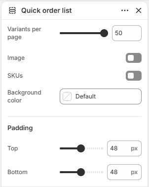

# Quick order list

Displays a table of product variants that customers can add to the cart in bulk.

## How to access

1. **Go to** Shopify Admin → Online Store → Themes.
2. **Click** Customize on your active theme.
3. Open a page such as **Home page** from the page picker.
4. Click **Add section** and choose **Quick order list**, or select an existing Quick order list section.

### Section Settings

| Setting | Description |
| ------- | ----------- |
| Variants per page | Sets the variants per page. Range: 5–50. |
| Image | Enables or disables image. |
| SKUs | Enables or disables SKUs. |
| Background color | Sets the background color. |
| Padding |  |
| Top | Sets the top padding. Range: 0–100 px. |
| Bottom | Sets the bottom padding. Range: 0–100 px. |
