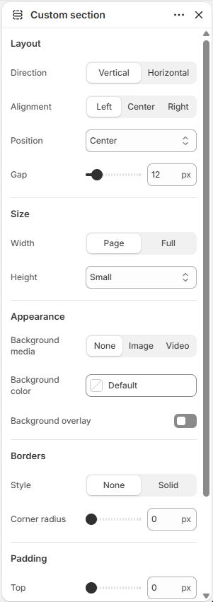

# Section

A flexible container for any combination of blocks, with its own background, border, and layout.

## How to access

1. **Go to** Shopify Admin → Online Store → Themes.
2. **Click** Customize on your active theme.
3. Open a page such as **Home page** from the page picker.
4. Click **Add section** and choose **Section**, or select an existing Section section. This section is also used on: Collections → Default collection, Pages → Contact.

### Section Settings

| Setting | Description |
| ------- | ----------- |
| Layout |  |
| Direction | Sets the direction for layout. Choose from Vertical or Horizontal. |
| Vertical on mobile | Enables or disables vertical on mobile. |
| Alignment | Sets the alignment for layout. Choose from Left, Center, Right, or Space between. |
| Position | Sets the position for layout. Choose from Top, Center, or Bottom. |
| Align text baseline | Turn on to align text baseline. |
| Alignment | Sets the alignment for layout. Choose from Left, Center, or Right. |
| Position | Sets the position for layout. Choose from Top, Center, Bottom, or Space between. |
| Gap | Sets the gap for layout. Range: 0–100 px. |
| Size |  |
| Width | Sets the width for size. Choose from Page or Full. |
| Height | Sets the height for size. Choose from Auto, Small, Medium, Large, Full screen, or Custom. |
| Custom height | Sets the custom height. Range: 0–100%. |
| Appearance |  |
| Background media | Sets the background media. Choose from None, Image, or Video. |
| Background color | Sets the background color. |
| Video | Selects the uploaded video. |
| Video position | Sets the video position. Choose from Cover or Contain. |
| Image | Selects the image. |
| Image position | Sets the image position. Choose from Cover or Fit. |
| Background overlay | Enables or disables background overlay. |
| Overlay color | Sets the overlay color. |
| Overlay style | Sets the overlay style. Choose from Solid or Gradient. |
| Gradient direction | Sets the gradient direction. Choose from Up or Down. |
| Borders |  |
| Style | Sets the style for borders. Choose from None or Solid. |
| Thickness | Sets the thickness for borders. Range: 0–100 px. |
| Opacity | Sets the opacity for borders. Range: 0–100%. |
| Color | Sets the color. |
| Corner radius | Sets the corner radius for borders. Range: 0–100 px. |
| Padding |  |
| Top | Sets the top padding. Range: 0–100 px. |
| Bottom | Sets the bottom padding. Range: 0–100 px. |

### Blocks

Add blocks to this section in the theme editor. Each block is a separate item you can add, remove, and reorder.

This section accepts **theme blocks** (text, button, image, group, and more). See [Theme blocks](../blocks/theme-blocks.md) for every block and its settings.

App blocks from installed apps can also be added to this section.

#### Divider

Adds a divider line.

| Setting | Description |
| ------- | ----------- |
| Thickness | Sets the thickness. Range: 0.5–5 px. |
| Corner radius | Sets the corner radius. Choose from Square or Rounded. |
| Color | Sets the color. |
| Length | Sets the length. Range: 5–100%. |
| Padding |  |
| Top | Sets the top padding. Range: 0–100 px. |
| Bottom | Sets the bottom padding. Range: 0–100 px. |

#### Accordion row

Adds a accordion row to the section.

| Setting | Description |
| ------- | ----------- |
| Heading | Sets the heading. |
| Open row by default | Turn on to open row by default. |
| Icon |  |
| Icon | Sets the icon for icon. Choose from None, Apple, Arrow, Banana, Bottle, Box, Carrot, Chat bubble, Check box, or Clipboard. |
| Image icon | Selects the image icon. |
| Width | Sets the width for icon. Range: 12–200 px. |
